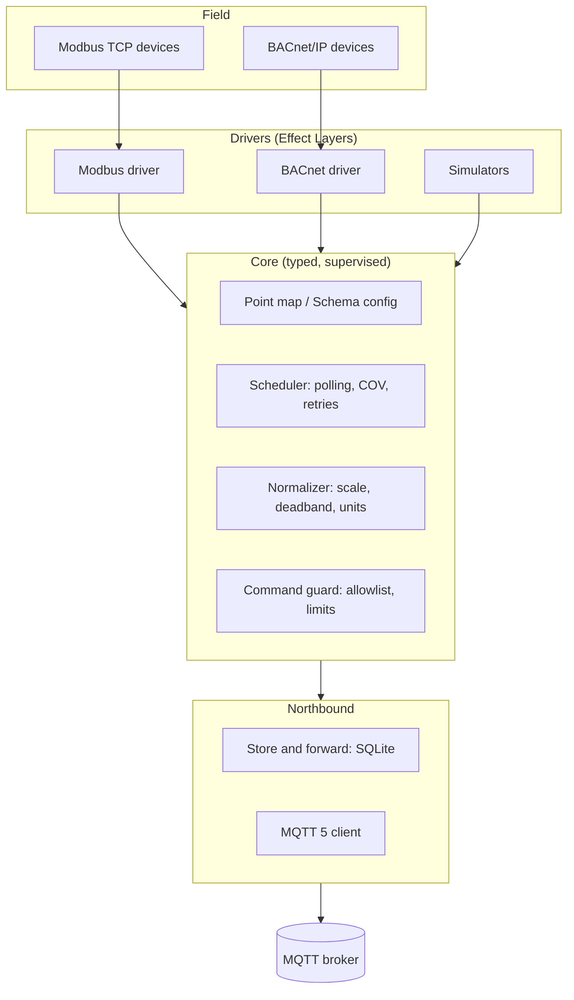

# Plenum

**An Effect-native edge gateway for buildings.**

Plenum runs on small Linux devices like a Raspberry Pi. It reads building protocols such as Modbus TCP and BACnet/IP, publishes clean, normalized data to MQTT, and carries commands back safely.

It is built on [Effect](https://effect.website) 4 for TypeScript. Polling, retries, timeouts, resource cleanup and failures are explicit, typed and testable, not hidden in callbacks or flow graphs. Plenum is both a library you compose in code and a ready-to-run gateway you configure with one JSON file.

> A _plenum_ is the space above ceilings and below floors where a building's cables and air ducts run. Plenum the project lives in the same place: out of sight, carrying everything.

> [!NOTE]
> Plenum is early. The core pipeline, config schema, Modbus TCP reads and MQTT 5 publishing work (v0.1); store-and-forward and BACnet are next. See the [roadmap](#roadmap).

## Why

Getting data out of a building is harder than it should be. Field devices speak Modbus and BACnet; modern platforms expect MQTT and structured data. The glue in between is usually a flow editor that hides failures, a closed vendor box, or a script nobody wants to touch after the first network drop.

Plenum treats field reality as normal: devices time out, brokers go offline, register maps are inconsistent. Each of those is a typed error the gateway handles on purpose, so it can run unattended for months and tell you exactly what went wrong when something does.

## Features

- **Effect-native.** Built on the Effect 4 ecosystem. The Modbus, BACnet/IP and MQTT 5 stacks are implemented in-house on Effect, with no third-party protocol libraries.
- **One JSON config**, validated with Effect Schema at startup. It can live in a file or a database and be edited by a web app.
- **Clean topics.** Values go to `site/building/device/point`, and metadata is retained on `.../point/$meta`.
- **Normalization.** Scaling, deadband and units (QUDT) are set per point.
- **Semantic tagging.** Each point can carry an optional Brick class and Haystack tags.
- **Unattended by default.** Retries with jittered backoff, supervised fibers, store-and-forward in SQLite (planned).
- **Safe writes.** Writing is opt-in per point, allowlisted and range-checked (planned).
- **Testable without hardware.** Every driver gets a simulator, and CI runs end to end.

## Quick start

Requirements: Node.js 22.18 or newer (24 LTS recommended) and pnpm 10.

```bash
git clone https://github.com/phocal-ai/plenum
cd plenum
pnpm install
pnpm check      # typecheck + tests across the workspace (Turborepo)
pnpm bench      # terminal 1: a local MQTT test broker and a Modbus TCP simulator
pnpm gateway    # terminal 2: run the gateway with examples/gateway.json
```

The bench prints every message the gateway publishes, from a simulated air handler and a simulated Modbus meter:

```text
[retained] demo-site/b1/ahu-1/supply-air-temp/$meta {"name":"AHU 1 supply air temperature","unit":"unit:DEG_C",...}
demo-site/b1/ahu-1/supply-air-temp {"value":20.99,"ts":1793631666939,"unit":"unit:DEG_C"}
demo-site/b1/main-meter/active-power {"value":32.67,"ts":1793631666941,"unit":"unit:KiloW"}
demo-site/b1/main-meter/breaker-tripped {"value":true,"ts":1793631666942}
```

Point `mqtt.url` at your own broker to publish there instead; the gateway keeps polling while the broker is down and reconnects on its own.

Plenum runs TypeScript directly on Node's built-in type stripping, so there is no build step during development.

## Configuration

A gateway is described by one JSON document:

```json
{
  "site": "vienna-hq",
  "building": "b1",
  "mqtt": { "url": "mqtt://broker.local:1883", "passwordEnv": "PLENUM_MQTT_PASSWORD" },
  "buffer": { "path": "/var/lib/plenum/buffer.sqlite" },
  "devices": [
    {
      "protocol": "modbus-tcp",
      "id": "main-meter",
      "host": "192.168.1.50",
      "pollIntervalMs": 5000,
      "points": [
        {
          "id": "active-power",
          "name": "Main meter active power",
          "unit": "unit:KiloW",
          "table": "holding",
          "address": 100,
          "dataType": "float32",
          "deadband": 0.1,
          "semantics": { "brick": "Active_Power_Sensor", "haystack": ["elec", "power", "active", "sensor"] }
        }
      ]
    }
  ]
}
```

IDs must be lowercase slugs, so they are always valid MQTT topic segments. Defaults such as port 502, unit ID 1 and a 5-second poll interval are applied when the config is decoded. See [`examples/gateway.json`](examples/gateway.json) and [`packages/core/src/Config.ts`](packages/core/src/Config.ts) for the full schema.

## Observability

The gateway exports traces, metrics and logs over OTLP when the standard OpenTelemetry environment variables are set (`OTEL_EXPORTER_OTLP_ENDPOINT`, `OTEL_EXPORTER_OTLP_HEADERS`, `OTEL_<SIGNAL>_EXPORTER=otlp`). Every polling cycle is a trace; metrics cover cycle outcomes and duration, read and publish failures, device and broker connections, and how long ago each device and point was last read. Without the variables nothing is exported. See [`observability/README.md`](observability/README.md).

## Packages

| Package                                   | What it does                                                                                    | Status             |
| ----------------------------------------- | ----------------------------------------------------------------------------------------------- | ------------------ |
| [`@plenum/core`](packages/core)           | Point model, config schema, normalization, topics, polling pipeline, `Publisher` service        | Working            |
| [`@plenum/simulator`](packages/simulator) | Simulated devices (sine, ramp, constant) for tests and demos                                    | Working            |
| [`@plenum/modbus`](packages/modbus)       | Modbus TCP: codec, read planner, client, driver and simulator server; writes in v0.4            | Reads working      |
| [`@plenum/mqtt`](packages/mqtt)           | MQTT 5: codecs, publishing client with reconnect and keep alive, `Publisher` layer, test broker | Publishing working |
| [`@plenum/bacnet`](packages/bacnet)       | BACnet/IP: BVLC codec started                                                                   | Early              |
| [`@plenum/gateway`](apps/gateway)         | Ready-to-run gateway, plus a local bench (test broker and Modbus simulator)                     | Working            |

## Architecture



Telemetry flows down from devices to the broker. Commands travel back up and must pass the command guard before they reach a device. The full picture is in [docs/VISION.md](docs/VISION.md).

## Roadmap

| Version          | Focus                                                                   |
| ---------------- | ----------------------------------------------------------------------- |
| v0.1 Foundation  | Core, Schema config, Modbus TCP, MQTT publish                           |
| v0.2 Reliability | SQLite store-and-forward, health topics, simulators and CI              |
| v0.3 BACnet/IP   | Discovery, ReadProperty, COV subscriptions                              |
| v0.4 Write-back  | MQTT commands, range limits, BACnet priority                            |
| v1.0 Production  | Local status page, packaging (container, systemd), docs, first building |

After v1.0 comes a Next.js configuration app, as a separate package.

## Contributing

Contributions are welcome. Read [CONTRIBUTING.md](CONTRIBUTING.md) first, and [CLAUDE.md](CLAUDE.md) if you work with an AI coding assistant.

## License

[MIT](LICENSE)
