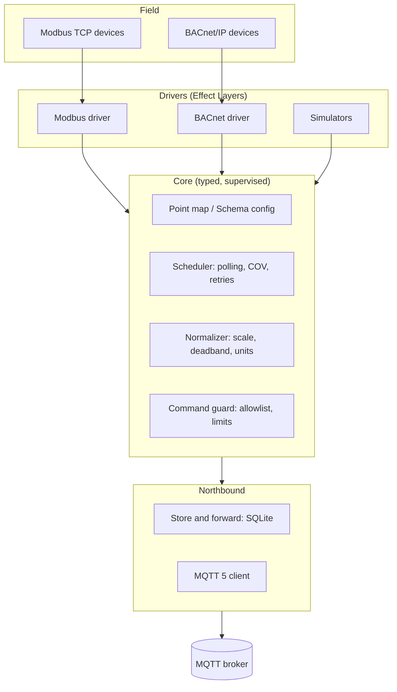

# Plenum

**An Effect-native edge gateway for buildings.**

Plenum runs on small Linux devices like a Raspberry Pi. It reads building protocols such as Modbus TCP and BACnet/IP, publishes clean, normalized data to MQTT, and carries commands back safely.

It is built on [Effect](https://effect.website) 4 for TypeScript. Polling, retries, timeouts, resource cleanup and failures are explicit, typed and testable, not hidden in callbacks or flow graphs. Plenum is both a library you compose in code and a ready-to-run gateway you configure with one JSON file.

> A _plenum_ is the space above ceilings and below floors where a building's cables and air ducts run. Plenum the project lives in the same place: out of sight, carrying everything.

> [!NOTE]
> Plenum is early. The core pipeline, config schema, Modbus TCP and BACnet/IP reads, MQTT 5 publishing, health topics and store-and-forward work; BACnet COV subscriptions are next. See the [roadmap](#roadmap).

## Why

Getting data out of a building is harder than it should be. Field devices speak Modbus and BACnet; modern platforms expect MQTT and structured data. The glue in between is usually a flow editor that hides failures, a closed vendor box, or a script nobody wants to touch after the first network drop.

Plenum treats field reality as normal: devices time out, brokers go offline, register maps are inconsistent. Each of those is a typed error the gateway handles on purpose, so it can run unattended for months and tell you exactly what went wrong when something does.

## Features

- **Effect-native.** Built on the Effect 4 ecosystem. The Modbus, BACnet/IP and MQTT 5 stacks are implemented in-house on Effect, with no third-party protocol libraries.
- **One JSON config**, validated with Effect Schema at startup. It can live in a file or a database and be edited by a web app.
- **Clean topics.** Values go to `site/building/device/point`, and metadata is retained on `.../point/$meta`.
- **Normalization.** Scaling, deadband and units (QUDT) are set per point.
- **Semantic tagging.** Each point can carry an optional Brick class and Haystack tags.
- **Unattended by default.** Retries with jittered backoff, supervised fibers, store-and-forward in SQLite.
- **Safe writes.** Writing is opt-in per point, range-checked, live-only and logged: a command is written once or not at all, never replayed.
- **Testable without hardware.** Every driver gets a simulator, and CI runs end to end.

## Quick start

Requirements: Node.js 22.18 or newer (24 LTS recommended) and pnpm 10.

```bash
git clone https://github.com/phocal-ai/plenum
cd plenum
pnpm install
pnpm check      # typecheck + tests across the workspace (Turborepo)
pnpm bench      # terminal 1: a local MQTT test broker, a Modbus TCP and a BACnet/IP simulator
pnpm gateway    # terminal 2: run the gateway with examples/gateway.json
```

The bench prints every message the gateway publishes, from a simulated air handler, a simulated Modbus meter and a simulated BACnet air handler:

```text
[retained] demo-site/b1/ahu-1/supply-air-temp/$meta {"name":"AHU 1 supply air temperature","unit":"unit:DEG_C",...}
demo-site/b1/ahu-1/supply-air-temp {"value":20.99,"ts":1793631666939,"unit":"unit:DEG_C"}
demo-site/b1/main-meter/active-power {"value":32.67,"ts":1793631666941,"unit":"unit:KiloW"}
demo-site/b1/main-meter/breaker-tripped {"value":true,"ts":1793631666942}
demo-site/b1/ahu-2/fan-running {"value":true,"ts":1793638119839}
```

Point `mqtt.url` at your own broker to publish there instead; the gateway keeps polling while the broker is down and reconnects on its own. Stop the bench for a few seconds and start it again: the values read in between arrive from the buffer.

Plenum runs TypeScript directly on Node's built-in type stripping, so there is no build step during development.

To check a config without connecting to anything:

```bash
node apps/gateway/src/main.ts --check path/to/gateway.json
```

## Running it for real

On a Raspberry Pi (64-bit OS) or any Linux machine with systemd and Node.js 22.18 or newer, from a checkout:

```bash
sudo packaging/install.sh path/to/gateway.json
```

It installs the gateway to `/opt/plenum` with its production dependencies, creates the `plenum` user, validates the config into `/etc/plenum/gateway.json` (with the outbox in `/var/lib/plenum`), and starts the `plenum-gateway` service, which restarts on failure and is held to 512 MB. Run it again to upgrade. Logs: `journalctl -u plenum-gateway -f`. Secrets (`passwordEnv`) and `OTEL_*` variables go in `/etc/plenum/gateway.env`.

Or as a container, for amd64 and arm64 (published for releases as `ghcr.io/phocal-ai/plenum-gateway`):

```bash
docker run -d --name plenum --network host --restart unless-stopped \
  -v /etc/plenum:/etc/plenum:ro -v /var/lib/plenum:/var/lib/plenum \
  ghcr.io/phocal-ai/plenum-gateway:latest
```

Host networking lets BACnet discovery hear broadcast I-Ams. The image reads `/etc/plenum/gateway.json`; point `buffer.path` under `/var/lib/plenum` so the outbox outlives the container.

## Configuration

A gateway is described by one JSON document:

```json
{
  "site": "vienna-hq",
  "building": "b1",
  "id": "main",
  "mqtt": { "url": "mqtt://broker.local:1883", "passwordEnv": "PLENUM_MQTT_PASSWORD" },
  "buffer": { "path": "/var/lib/plenum/buffer.sqlite" },
  "devices": [
    {
      "protocol": "modbus-tcp",
      "id": "main-meter",
      "host": "192.168.1.50",
      "pollIntervalMs": 5000,
      "points": [
        {
          "id": "active-power",
          "name": "Main meter active power",
          "unit": "unit:KiloW",
          "table": "holding",
          "address": 100,
          "dataType": "float32",
          "deadband": 0.1,
          "semantics": { "brick": "Active_Power_Sensor", "haystack": ["elec", "power", "active", "sensor"] }
        }
      ]
    },
    {
      "protocol": "bacnet-ip",
      "id": "ahu-2",
      "deviceInstance": 2001,
      "points": [
        { "id": "supply-air-temp", "name": "AHU 2 supply air temperature", "objectType": "analog-input", "instance": 1 }
      ]
    }
  ],
  "bacnet": { "broadcastAddress": "192.168.1.255" }
}
```

With `buffer`, values read while the broker is unreachable are kept in that SQLite file (up to `maxRows`, default 1,000,000, oldest dropped first) and delivered in order once it is back, also after a gateway restart. Without it, they are lost. See [`@plenum/buffer`](packages/buffer).

BACnet devices are found by `deviceInstance` with Who-Is, or reached directly at `address` (`ip` or `ip:port`). A point reads `present-value` of its object unless it names another `property`. With `cov` (default `true`) the gateway subscribes to change-of-value notifications for present values and polls only what they do not cover. Every BACnet device shares one UDP socket, set in the optional `bacnet` block: `bindAddress` (default `0.0.0.0`; on Linux, binding one address stops broadcasts from arriving), `port` (47808; devices broadcast I-Am there), `broadcastAddress` (`255.255.255.255`, port 47808 unless given; set your subnet's, since the default leaves through one interface only), `requestTimeoutMs` (3000), `retries` (2), `covLifetimeSeconds` (300, the lifetime requested for change-of-value subscriptions, renewed at half of it) and `bbmdAddress` (`ip` or `ip:port` of the subnet's BBMD; only it may forward answers to the gateway, and without it only the device itself may). See [`@plenum/bacnet`](packages/bacnet).

Every device has an optional `cycleTimeoutMs`: how long one polling cycle (the read with its retries, and publishing the values) may take before it is abandoned as hung, counted as `timed_out` and reported as `cycle-timeout` in the health topic. It defaults to twice `pollIntervalMs` and at least `pollIntervalMs` plus 30 seconds; raise it for a slow device with many points.

IDs must be lowercase slugs of at most 64 characters, so they are always valid MQTT topic segments. Device ids are unique within the gateway and point ids within their device, since each names a topic. The config is checked strictly: a key the schema does not know (a typo such as `intervall`) fails the start with its path instead of being ignored, every device needs at least one point, `host` and the broker `url` must not be empty, a `deadband` cannot be negative and a scaling `factor` cannot be 0. A JSON syntax error reports its position. Defaults such as gateway ID `main`, port 502, unit ID 1 and a 5-second poll interval are applied when the config is decoded. See [`examples/gateway.json`](examples/gateway.json) and [`packages/core/src/Config.ts`](packages/core/src/Config.ts) for the full schema.

## Topics

| Topic                                    | Retained | Payload                                                                                          |
| ---------------------------------------- | -------- | ------------------------------------------------------------------------------------------------ |
| `site/building/device/point`             | no       | `{"value":21.5,"ts":1793631666939,"unit":"unit:DEG_C"}` when the value moves beyond the deadband |
| `site/building/device/point/$meta`       | yes      | name, unit, writability and Brick/Haystack semantics                                             |
| `site/building/$gateway/<id>/health`     | yes      | `online` with per-device status, or `offline` (see below)                                        |
| `site/building/device/point/$set`        | never    | a command to the gateway: `{"value":21.5}` (see Commands)                                        |
| `site/building/device/point/$set/result` | no       | the command's result, unless the command named an MQTT 5 response topic                          |

The health topic says `{"status":"online","since":…,"ts":…,"devices":{…}}` on every connect and every `healthIntervalMs` (default 60 s), with each device `starting`, `ok` or `failing` (plus `lastSuccess` and the failure `reason`: the driver's `timeout`, `connection`, `protocol`, …, `cycle-timeout` when a polling cycle hung past its deadline, or `crashed` when the device's pipeline hit a bug and is being restarted). The gateway registers `{"status":"offline","reason":"connection-lost"}` as its MQTT last will, so the broker announces a crash or a lost network on its own, and publishes `"reason":"shutdown"` itself when it stops cleanly. After a reconnect the gateway publishes its retained messages again, so a broker that restarted without persistence gets them back.

## Commands

A point with `"writable": true` takes commands on `site/building/device/point/$set`, as `{"value": 21.5}` (a number, `true`/`false` for a coil, bool register or binary object, or `null` to release a BACnet point). The gateway subscribes only when some point is writable. A command is written only if all of these hold, and otherwise refused without touching the device:

- it is live: a retained command is refused every time it is seen (the gateway subscribes with Retain As Published, so it sees the flag even when it is online), since it would otherwise be applied again after every reconnect;
- the point exists and is writable;
- the value has the point's type, and a number lies within the point's `limits` (`{"min": 15, "max": 25}`, in engineering units, required on every writable numeric point);
- the session is clean: a command sent while the gateway was offline is never delivered later.

The value is unscaled into device units and written once, with a 10 s deadline: Modbus with FC 05 (coil), FC 06 (one register) or FC 16 (32-bit values, both halves in one request), never resent; BACnet with WriteProperty at the point's `priority` (default 8, manual operator; 1 to 16, not 6). A BACnet client resends a request whose answer was lost, as the standard has it, so a device may apply the same value at the same priority twice in a row, which leaves the same state; another BACnet client writing the same priority slot within those seconds could be overwritten.

Every command gets one result, `{"status":"written","value":21.5,"ts":…}`, or `rejected` / `failed` with a `reason` (`retained`, `unknown-point`, `not-writable`, `invalid-payload`, `wrong-type`, `out-of-range`; `device-unavailable`, `timeout`, or the driver's reason) and a `message`. It goes to the MQTT 5 Response Topic the command named, with its Correlation Data, or to `…/$set/result`. Results are not buffered: delivered now or not at all. Every command is logged and counted in `plenum_commands_total{outcome,reason}`. Who may publish to `$set` topics is the broker's business: restrict it with the broker's ACLs.

## Observability

The gateway exports traces, metrics and logs over OTLP when the standard OpenTelemetry environment variables are set (`OTEL_EXPORTER_OTLP_ENDPOINT`, `OTEL_EXPORTER_OTLP_HEADERS`, `OTEL_<SIGNAL>_EXPORTER=otlp`). Every polling cycle is a trace; metrics cover cycle outcomes and duration, read and publish failures, device and broker connections, and how long ago each device was last read successfully. Without the variables nothing is exported. See [`observability/README.md`](observability/README.md).

## Packages

| Package                                   | What it does                                                                                         | Status  |
| ----------------------------------------- | ---------------------------------------------------------------------------------------------------- | ------- |
| [`@plenum/core`](packages/core)           | Point model, config schema, normalization, topics, polling pipeline, health, `Publisher` service     | Working |
| [`@plenum/simulator`](packages/simulator) | Simulated devices (sine, ramp, constant) for tests and demos                                         | Working |
| [`@plenum/modbus`](packages/modbus)       | Modbus TCP: codec, read planner, client, driver and simulator server, with writes                    | Working |
| [`@plenum/buffer`](packages/buffer)       | Store-and-forward: SQLite outbox that keeps values during broker outages and delivers them in order  | Working |
| [`@plenum/mqtt`](packages/mqtt)           | MQTT 5: codecs, client with reconnect, keep alive and subscriptions, `Publisher` layer, test broker  | Working |
| [`@plenum/bacnet`](packages/bacnet)       | BACnet/IP: codecs, Who-Is discovery, ReadProperty(Multiple), COV and WriteProperty, simulator server | Working |
| [`@plenum/gateway`](apps/gateway)         | Ready-to-run gateway, plus a local bench (test broker, Modbus and BACnet simulators)                 | Working |

## Architecture



Telemetry flows down from devices to the broker. Commands travel back up and must pass the command guard before they reach a device. The full picture is in [docs/VISION.md](docs/VISION.md).

## Roadmap

| Version          | Focus                                                                   |
| ---------------- | ----------------------------------------------------------------------- |
| v0.1 Foundation  | Core, Schema config, Modbus TCP, MQTT publish                           |
| v0.2 Reliability | SQLite store-and-forward, health topics, simulators and CI              |
| v0.3 BACnet/IP   | Discovery, ReadProperty, COV subscriptions                              |
| v0.4 Write-back  | MQTT commands, range limits, BACnet priority                            |
| v1.0 Production  | Local status page, packaging (container, systemd), docs, first building |

After v1.0 comes a Next.js configuration app, as a separate package.

## Contributing

Contributions are welcome. Read [CONTRIBUTING.md](CONTRIBUTING.md) first, and [CLAUDE.md](CLAUDE.md) if you work with an AI coding assistant.

## License

[MIT](LICENSE)
