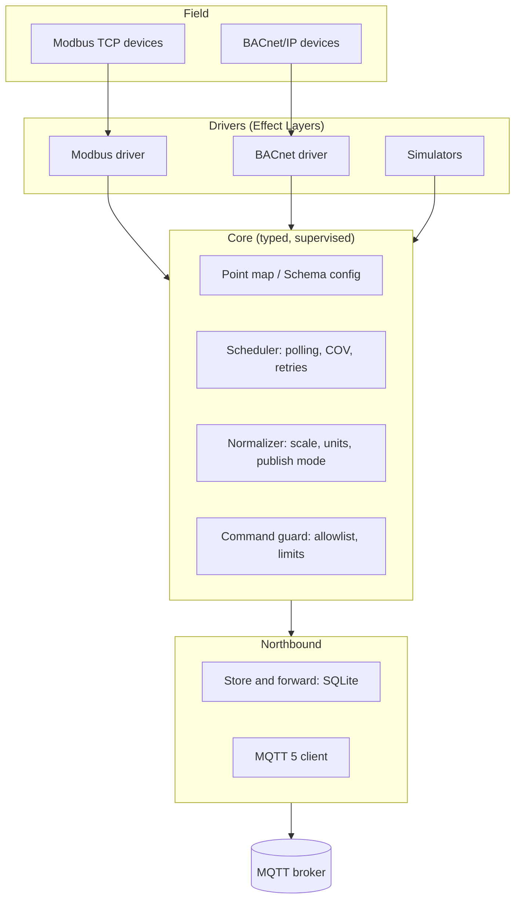

# OT Gateway

**An open-source OT gateway for buildings and industrial sites, set up and debugged with your AI agent.**

OT Gateway gets the values you care about out of a site's meters and controllers and into your software. It runs as one container wherever Docker runs (a mini PC, an industrial PC, a server, a Raspberry Pi), reads protocols such as Modbus TCP and BACnet/IP, and forwards clean, named values with units as standard MQTT, without losing values when the connection drops. Debugging and telemetry are built in: a local status page, a health message and OpenTelemetry. [How it works](docs/how-it-works.md) explains it with one example building.

It is built on [Effect](https://effect.website) 4 for TypeScript. Polling, retries, timeouts, resource cleanup and failures are explicit, typed and testable, not hidden in callbacks or flow graphs. OT Gateway is both a library you compose in code and a ready-to-run gateway you configure with one JSON file.

> OT is operational technology: the controllers, meters and field buses that run a building or a plant, as opposed to its IT. OT Gateway sits between the two, and it was called Plenum until v0.5.0 ([moving from Plenum](docs/operations.md#moving-from-plenum)).

> [!NOTE]
> OT Gateway is early. The core pipeline, config schema, Modbus TCP and BACnet/IP reads, MQTT 5 publishing (3.1.1 for older brokers), health topics and store-and-forward work; BACnet COV subscriptions are next. See the [roadmap](#roadmap).

## Why

Getting data out of a building or a plant is harder than it should be. Field devices speak Modbus and BACnet; modern platforms expect MQTT and structured data. The glue in between is usually a flow editor that hides failures, a closed vendor box, an industrial controller that costs thousands per site and a specialist per change, or a script nobody wants to touch after the first network drop.

OT Gateway treats field reality as normal: devices time out, brokers go offline, register maps are inconsistent. Each of those is a typed error the gateway handles on purpose, so it can run unattended for months and tell you exactly what went wrong when something does.

## Features

- **Effect-native.** Built on the Effect 4 ecosystem. The Modbus, BACnet/IP and MQTT 5 stacks are implemented in-house on Effect, with no third-party protocol libraries.
- **One JSON config**, validated with Effect Schema at startup. It can live in a file or a database and be edited by a web app.
- **Clean topics.** Values go to `site/building/device/point`, and metadata is retained on `.../point/$meta`.
- **Normalization.** Scaling and units (QUDT) are set per point.
- **Read and send on their own schedules.** Poll every 5 seconds and send each read, the latest once a minute, clock-aligned 15-minute aggregates (min, max, time-weighted average), or only changes beyond a deadband: per device or per point.
- **Semantic tagging.** Each point can carry an optional Brick class and Haystack tags.
- **Unattended by default.** Retries with jittered backoff, supervised fibers, store-and-forward in SQLite.
- **Safe writes.** Writing is opt-in per point, range-checked, live-only and logged: a command is written once or not at all, never replayed.
- **Testable without hardware.** Every driver gets a simulator, and CI runs end to end.

## Quick start

Three steps, each a little closer to your own building.

### 1. See it work

One minute, no devices needed. With [Docker Desktop](https://www.docker.com/products/docker-desktop/) (or any Docker):

```bash
docker run --rm -it -p 127.0.0.1:8080:8080 ghcr.io/phocal-ai/ot-gateway demo
```

Or from a checkout, with Node.js 22.18 or newer (24 LTS recommended) and pnpm 10:

```bash
git clone https://github.com/phocal-ai/ot-gateway
cd ot-gateway
pnpm install
pnpm demo
```

The demo is a small site on your computer: a simulated energy meter (Modbus), a heat pump (BACnet) and a PV inverter, the gateway reading them, and a test MQTT broker receiving what it sends. Nothing leaves your machine. The terminal prints every message the broker receives:

```text
[retained] demo-site/building-a/heat-pump/flow-temp/$meta {"name":"Heat pump flow temperature","unit":"unit:DEG_C",...}
demo-site/building-a/heat-pump/flow-temp {"value":35.44,"ts":1793631666939,"unit":"unit:DEG_C"}
demo-site/building-a/pv-inverter/ac-power {"value":6.02,"ts":1793631666940,"unit":"unit:KiloW"}
demo-site/building-a/energy-meter/active-power {"value":32.67,"ts":1793631666941,"unit":"unit:KiloW"}
demo-site/building-a/energy-meter/breaker-tripped {"value":true,"ts":1793631666942}
demo-site/building-a/heat-pump/compressor-running {"value":true,"ts":1793638119839}
```

### 2. Look around

Open the status page at <http://localhost:8080>. The Status tab is the overview: the broker, the devices and the buffer (click a card for its details: what the broker allowed, reconnects and publishes, devices by state and protocol, what the buffer stored, sent and dropped), a notice when the machine has a problem, and every device with its health (failing and late ones first; a large site lists ten until you ask for all). The Points tab lists every configured point with its live value, its device's health, where it is read and how it is published; search it by id, name, topic, register or Brick class, or click a device on the Status tab to see its points. Click a point to open it in a side panel with its history over 15 minutes to 7 days, updated live, and its configuration; ↑ and ↓ step through the list. The filter and the open point stay in the URL, so a view can be linked. The Messages tab shows what the gateway publishes, the latest message on each topic as a subscriber sees it, searchable by topic and payload and filtered by kind (values, metadata, health, command results). The Settings tab shows the config the gateway runs with, defaults filled in, read-only: change it in the config file and restart. The list draws only the rows on screen and asks for only their values, so a site with tens of thousands of points scrolls as one list. `GET /api/status`, `GET /api/messages`, `GET /api/points`, `GET /api/config` and `GET /api/history` have the same as JSON; `GET /api/status?points=none` leaves out every point's value, and `GET /api/values?points=device/point,device/point` gives the last reads of up to 500 points.

To watch the data arrive on a real broker, `pnpm demo --public` (or `demo --public` in the `docker run` line) publishes the same simulated data to a public test broker: the first of broker.hivemq.com, broker.emqx.io and test.mosquitto.org that answers, under a site id of its own such as `demo-3e15e2`. It prints the `mosquitto_sub` command and the MQTT Explorer settings to watch it with. Anyone can read a public broker, so the gateway refuses one for any device that is not simulated on this machine.

### 3. Your own building

You know which values you want, from which devices, and how often. `ot-gateway init` turns that into a config in a few questions, and finds BACnet devices on its own: [Your first building](docs/first-building.md) walks through it, from a points list to values on your broker. Or let a coding agent do it: [Set it up with AI](#set-it-up-with-ai).

The `ot-gateway` command (`pnpm ot-gateway …` in a checkout, which also loads secrets from `ot-gateway.env`; `node apps/gateway/src/main.ts …` anywhere):

| Command                              | What it does                                                                                                                                                                                              |
| ------------------------------------ | --------------------------------------------------------------------------------------------------------------------------------------------------------------------------------------------------------- |
| `ot-gateway demo`                    | the demo above                                                                                                                                                                                            |
| `ot-gateway init [folder]`           | ask for the site, broker and devices (or take them as flags with `--yes`), and write `ot-gateway.json`, `compose.yaml` and `ot-gateway.env` in the folder (`.` for this one); `--dry-run` only shows them |
| `ot-gateway run [config]`            | run the gateway with that config                                                                                                                                                                          |
| `ot-gateway check [config]`          | validate a config without connecting to anything, listing every mistake with its path (`--json` for agents)                                                                                               |
| `ot-gateway discover [config]`       | find BACnet devices and print a draft of their config, or write it as a points list with `--points-list` (below)                                                                                          |
| `ot-gateway import <csv> [config]`   | add the devices of a points list to the config ([the columns](docs/first-building.md#3-add-your-modbus-points)); `--dry-run` only checks it                                                               |
| `ot-gateway points schema\|template` | the points list's columns (`--json` for agents), or a list to fill in; `points from-ede` turns a BACnet EDE file into one                                                                                 |
| `ot-gateway profiles list\|show`     | the device profiles a points list can name in its `profile` column, so one row takes a meter's registers (`--json` for agents)                                                                            |
| `ot-gateway watch [config]`          | print every message under the config's site and building as it reaches the broker, until Ctrl-C or for `--seconds N` (which fails when the broker cannot be reached)                                      |
| `ot-gateway broker [config]`         | connect to the config's broker: the MQTT it speaks (5 or 3.1.1), what it allows, and a message there and back, failing (exit code 1) when it does not come back (`--json` for agents)                     |
| `ot-gateway publish <topic> [msg]`   | send one message as the gateway's user; `--retain` with no message clears what the broker keeps on a topic (`--qos 0\|1`, `--json`)                                                                       |
| `ot-gateway status [--url]`          | the running gateway's broker, buffer and devices, one line each (`--json` for agents)                                                                                                                     |
| `ot-gateway --help`                  | every command and flag; `--log-level debug` works with all of them                                                                                                                                        |

For scripts and AI agents: nothing asks without a terminal, and `--json` on `init`, `check`, `discover`, `import`, `points schema`, `broker`, `publish` and `status` prints the result as JSON on stdout, a failure too (`{"ok": false, "error": …}`, exit code 1); logs go to stderr. A mistyped command gets the one you probably meant.

### Working on the gateway

To work on the gateway itself, run the bench and the gateway as two processes instead: `pnpm bench` in one terminal (the broker and the simulated devices, printing every message) and `pnpm gateway` in another (the gateway with `examples/gateway.json`, after building the status page; Turborepo replays that build from its cache unless the page changed). Point `mqtt.url` at your own broker to publish there instead; the gateway keeps polling while the broker is down and reconnects on its own. Stop the bench for a few seconds and start it again: the values read in between arrive from the buffer. `pnpm check` runs the format check, lint, typecheck and every test (about 30 s).

OT Gateway runs TypeScript directly on Node's built-in type stripping, so there is no build step during development.

## Set it up with AI

The fastest way to your own building is to let a coding agent do it. In [Claude Code](https://claude.com/claude-code), from the checkout:

```text
/setup
```

The skill checks Node, shows the demo, then asks about your devices and broker in one round. It writes the gateway's folder with `ot-gateway init`, turns BACnet discovery, an EDE file, your points list or Modbus datasheets into the standard points list, and checks it with the CLI. Then it runs the gateway until values flow and, on request, starts it with Docker Compose. It never makes a point writable unless you ask.

With any other agent that can run commands (Cursor, Codex, Gemini CLI, …), paste:

```text
Set up an OT Gateway for my site. Read
https://raw.githubusercontent.com/phocal-ai/ot-gateway/main/.claude/skills/setup/SKILL.md and follow it
step by step, with npx ot-gateway and no clone: run the commands yourself, ask me only what you cannot
find out, never write to a device, and keep secrets out of the JSON config. Stop when values from my
devices reach the broker.
```

To have your agent reach for the CLI on its own, add one line to its instructions (`AGENTS.md`, `CLAUDE.md`):

```text
For OT Gateway configs, points lists and folders, use `npx ot-gateway`; start with `npx ot-gateway --help`.
```

To draft BACnet points yourself, `discover` finds the devices through the config's `bacnet` settings. It prints their `devices` entries, with object names as ids and QUDT units, all read-only:

```bash
pnpm ot-gateway discover path/to/gateway.json
pnpm ot-gateway discover --points-list points.csv   # the same as a points list: delete the rows you don't need, then import it (fails when the file exists or nothing answered)
pnpm ot-gateway discover --address 10.20.3.40:47809  # only the device at that address: another subnet without a BBMD, or another port
```

Before you make any point of a device writable, confirm its drafted `address` against a source you trust (commissioning sheet, device display, DHCP reservation). A device that answered from more than one address (two devices sharing an instance, or one device on several addresses) gets a warning and no `address` in the draft: take it from that source, and use the warning's list only to see which hosts to check. Once a device in the config has an `address`, `discover` reads it there and drafts the points it does not have yet.

## Running it for real

Once values flow, the gateway belongs on a machine that stays on in the building: any Linux machine with Docker (a mini PC, an industrial PC, a NAS, a server, a VM) or a Raspberry Pi. [docs/operations.md](docs/operations.md) covers installing, upgrading, the outbox, logs and the status page in full; [docs/raspberry-pi-install.md](docs/raspberry-pi-install.md) takes a Raspberry Pi from a blank SD card to a running gateway; [docs/troubleshooting.md](docs/troubleshooting.md) goes from symptom to cause.

The recommended way is the container, with Docker Compose: one image (`ghcr.io/phocal-ai/ot-gateway`, amd64 and arm64, published for releases) for an industrial PC as much as for a Raspberry Pi on the 64-bit OS.

```bash
curl -fsSLO https://raw.githubusercontent.com/phocal-ai/ot-gateway/main/packaging/compose.yaml
docker compose up -d
```

Run both in a folder with your `ot-gateway.json` (and `ot-gateway.env` for secrets, if the config names any). No `sudo` and no folders to make: the outbox and the history go to a Docker volume, and relative paths in the config land in it. [`packaging/compose.yaml`](packaging/compose.yaml) pins a release tag (write another into it and `docker compose up -d` to upgrade or go back, [docs/operations.md](docs/operations.md#upgrade)), uses host networking so BACnet discovery hears broadcast I-Ams, restarts on failure and caps Docker's log files. The image includes the status page. An install from v0.7.0 or earlier, with the config in `/etc/ot-gateway`, moves over as [docs/operations.md](docs/operations.md#from-the-etcot-gateway-layout-v070-and-earlier) shows.

On a machine without Docker, with systemd and Node.js 22.18 or newer, from a checkout owned by you or root (the script refuses one that others can write to):

```bash
sudo packaging/install.sh path/to/gateway.json
```

It installs the gateway to `/opt/ot-gateway` with its production dependencies, creates the `ot-gateway` user, validates the config into `/etc/ot-gateway/gateway.json` (with the outbox in `/var/lib/ot-gateway`), and starts the `ot-gateway` service, which restarts on failure and is held to 512 MB. Run it again to upgrade. Logs: `journalctl -u ot-gateway -f`. Secrets (`passwordEnv`) and `OTEL_*` variables go in `/etc/ot-gateway/gateway.env`. Build the status page first (`pnpm --filter @ot-gateway/web build`, on any machine) and the script installs it too.

Either way, the gateway watches the machine it runs on (memory, event-loop lag, temperature, Raspberry Pi under-voltage and throttling, though only under-voltage on Raspberry Pi kernel 6.12 and later, disk, clock steps) and reports it on the status page, in the health message and in telemetry. [docs/raspberry-pi-testing.md](docs/raspberry-pi-testing.md) is how to test it on a Pi before it goes into a building.

The status page listens on `127.0.0.1` only, by default, and then answers only requests addressed to a loopback name, so a web page cannot reach it through DNS rebinding. From another machine, use an SSH tunnel (`ssh -L 8080:127.0.0.1:8080 pi@gateway`), or set `status.bindAddress` to `0.0.0.0` on a network you trust: the page is read-only, but it has no login.

## Configuration

A gateway is described by one JSON document; [docs/configuration.md](docs/configuration.md) lists every key with its default.

```json
{
  "site": "site-1",
  "building": "building-a",
  "id": "main",
  "mqtt": { "url": "mqtts://broker.local:8883", "passwordEnv": "OT_GATEWAY_MQTT_PASSWORD" },
  "buffer": { "path": "/var/lib/ot-gateway/buffer.sqlite" },
  "history": { "path": "/var/lib/ot-gateway/history.sqlite" },
  "devices": [
    {
      "protocol": "modbus-tcp",
      "id": "energy-meter",
      "host": "192.168.1.50",
      "pollIntervalMs": 5000,
      "publish": { "mode": "aggregate", "intervalMs": 900000 },
      "points": [
        {
          "id": "active-power",
          "name": "Energy meter active power",
          "unit": "unit:KiloW",
          "table": "holding",
          "address": 100,
          "dataType": "float32",
          "semantics": { "brick": "Active_Power_Sensor", "haystack": ["elec", "power", "active", "sensor"] }
        }
      ]
    },
    {
      "protocol": "bacnet-ip",
      "id": "heat-pump",
      "deviceInstance": 2001,
      "points": [
        {
          "id": "flow-temp",
          "name": "Heat pump flow temperature",
          "objectType": "analog-input",
          "instance": 1,
          "deadband": 0.2
        }
      ]
    }
  ],
  "bacnet": { "broadcastAddress": "192.168.1.255" }
}
```

`publish` decides what goes out, apart from how often the device is read. Without it, every read is sent. `{ "mode": "sample", "intervalMs": 60000 }` sends the latest value once a minute; `{ "mode": "aggregate", "intervalMs": 900000 }` sends minimum, maximum, time-weighted average, last value and count for each 15 minutes, in windows aligned to the clock; `{ "mode": "change", "deadband": 0.2, "maxSilenceMs": 3600000 }` sends when the value moves at least 0.2 and at least hourly. A point's own `publish` or `deadband` (short for change mode) overrides its device's. Above, the meter sends 15-minute aggregates and the heat pump's flow temperature its changes. See [publish](docs/configuration.md#publish), with what each mode costs in traffic and buffer.

With `history`, every read is kept on the gateway, each one for a day and per minute for `retentionDays` (7), for the status page's charts and `GET /api/history`. See [history](docs/configuration.md#history).

With `buffer`, values read while the broker is unreachable are kept in that SQLite file (up to `maxRows`, default 1,000,000, oldest dropped first) and delivered in order once it is back, also after a gateway restart. Without it, they are lost. See [`@ot-gateway/buffer`](packages/buffer).

A Modbus point's `dataType` is `int16`, `uint16`, `int32`, `uint32`, `float32`, `int64`, `uint64`, `float64` or `bool`; 32-bit values take two registers and 64-bit ones four. Modbus fixes the byte order only within a register, so devices differ in how they spread a wider value: `byteOrder` is `ABCD` (high word first, the default), `CDAB` (low word first, common on meters), `BADC` (bytes swapped in each register) or `DCBA` (little-endian). A float32 that reads as something like `1.4e-41` where `21.5` belongs means the byte order is wrong. A 64-bit integer is exact up to 2^53. A point with `bit` (0–15) is one flag of a status register, `true` or `false`. Several devices behind one Modbus TCP gateway (RS-485 meters, say) are one device each with the gateway's `host` and `port` and their own `unitId`; they share one connection. For awkward devices, a Modbus device takes `requestGapMs` (a pause between requests, for gateways and serial bridges that drop requests sent back to back) and `maxRegistersPerRead` / `maxBitsPerRead` (shorter reads).

BACnet devices are found by `deviceInstance` with Who-Is, or reached directly at `address` (`ip` or `ip:port`). A point reads `present-value` of its object unless it names another `property`. With `cov` (default `true`) the gateway subscribes to change-of-value notifications for present values and polls only what they do not cover. Every BACnet device shares one UDP socket, set in the optional `bacnet` block: `bindAddress` (default `0.0.0.0`; on Linux, binding one address stops broadcasts from arriving), `port` (47808; devices broadcast I-Am there), `broadcastAddress` (`255.255.255.255`, port 47808 unless given; set your subnet's, since the default leaves through one interface only), `requestTimeoutMs` (3000), `retries` (2), `covLifetimeSeconds` (300, the lifetime requested for change-of-value subscriptions, renewed at half of it) and `bbmdAddress` (`ip` or `ip:port` of the subnet's BBMD; only it may forward answers to the gateway, and without it only the device itself may). See [`@ot-gateway/bacnet`](packages/bacnet).

With `status`, the gateway serves its local status page and `GET /api/status` on `bindAddress` (default `127.0.0.1`) and `port` (default `8080`). `webRoot` points at another build of the page; by default it is `apps/web/out`. The page is read-only: commands reach devices only over MQTT and the command guard. If the port is taken, the gateway logs it and runs on without the page. Leave `status` out to serve nothing.

Every device has an optional `cycleTimeoutMs`: how long one polling cycle (the read with its retries, and publishing the values) may take before it is abandoned as hung, counted as `timed_out` and reported as `cycle-timeout` in the health topic. It defaults to twice `pollIntervalMs` and at least `pollIntervalMs` plus 30 seconds; raise it for a slow device with many points.

IDs must be lowercase slugs of at most 64 characters, so they are always valid MQTT topic segments. Device ids are unique within the gateway and point ids within their device, since each names a topic. The config is checked strictly: a key the schema does not know (a typo such as `intervall`) fails the start with its path instead of being ignored, every device needs at least one point, `host` and the broker `url` must not be empty, a `deadband` cannot be negative, a publish interval must divide a day and be no shorter than the device's poll interval, and a scaling `factor` cannot be 0. A JSON syntax error reports its position. Defaults such as gateway ID `main`, port 502, unit ID 1 and a 5-second poll interval are applied when the config is decoded. See [`examples/gateway.json`](examples/gateway.json) and [`packages/core/src/Config.ts`](packages/core/src/Config.ts) for the full schema.

More examples in [`examples/`](examples/):

- [`gateway.json`](examples/gateway.json): the demo, an energy meter, a PV inverter and a heat pump.
- [`building.json`](examples/building.json): a building on BACnet/IP, with a heating plant, ventilation and a meeting room.
- [`industrial.json`](examples/industrial.json): a hall on Modbus TCP, with an air compressor, a water tank and a machine's meter.
- [`points.csv`](examples/points.csv) and [`building.ede.csv`](examples/building.ede.csv): a points list and a BACnet EDE file to import.

## Topics

| Topic                                    | Retained | Payload                                                                                                                                                        |
| ---------------------------------------- | -------- | -------------------------------------------------------------------------------------------------------------------------------------------------------------- |
| `site/building/device/point`             | no       | `{"value":21.5,"ts":1793631666939,"unit":"unit:DEG_C"}`, when the point's publish mode says; aggregates add `min`, `max`, `avg`, `last`, `count`, `from`, `to` |
| `site/building/device/point/$meta`       | yes      | name, unit, writability, publish mode and Brick/Haystack semantics                                                                                             |
| `site/building/$gateway/<id>/health`     | yes      | `online` with per-device status, or `offline` (see below)                                                                                                      |
| `site/building/device/point/$set`        | never    | a command to the gateway: `{"value":21.5}` (see Commands)                                                                                                      |
| `site/building/device/point/$set/result` | no       | the command's result, with the command's correlation data                                                                                                      |

The health topic says `{"status":"online","since":…,"ts":…,"devices":{…}}` on every connect and every `healthIntervalMs` (default 60 s), with each device `starting`, `ok` or `failing` (plus `lastSuccess` and the failure `reason`: the driver's `timeout`, `connection`, `protocol`, …, `cycle-timeout` when a polling cycle hung past its deadline, or `crashed` when the device's pipeline hit a bug and is being restarted). The gateway registers `{"status":"offline","reason":"connection-lost"}` as its MQTT last will, so the broker announces a crash or a lost network on its own, and publishes `"reason":"shutdown"` itself when it stops cleanly. After a reconnect the gateway publishes its retained messages again, so a broker that restarted without persistence gets them back. A point renamed or removed from the config would leave its retained `$meta` behind, describing a point that no longer exists: on every connect the gateway reads the retained `$meta` of its own devices and clears those of points it no longer has. A device's topics belong to the gateway that has the device in its config, so other gateways' devices in the same building are never touched, and neither is the metadata of a device removed from the config: clear that with `mosquitto_pub -r -n -t 'site/building/device/point/$meta'`.

## Commands

A point with `"writable": true` takes commands on `site/building/device/point/$set`, as `{"value": 21.5}` and nothing else beside it (a number, `true`/`false` for a coil, bool register or binary object, a whole number from 1 for a BACnet multi-state object, or `null` to release a BACnet point). The gateway subscribes only when some point is writable, with No Local, so nothing it publishes itself is ever taken for a command. A command is written only if all of these hold, and otherwise refused without touching the device:

- it is live: a retained command is refused every time it is seen (the gateway subscribes with Retain As Published, so it sees the flag even when it is online), since it would otherwise be applied again after every reconnect;
- the point exists and is writable (a BACnet device with writable points needs a fixed `address`, so a spoofed I-Am cannot redirect its writes);
- the value has the point's type, and a number lies within the point's `limits` (`{"min": 15, "max": 25}`, in engineering units, required on every writable numeric point);
- the session is clean: a command sent while the gateway was offline is never delivered later;
- it is fresh: a command that waited more than 10 s for its turn (or longer than its MQTT message expiry) is refused as `expired` rather than applied late. Each device has its own queue, so a device that stops answering delays only its own commands. Up to 16 commands wait per device; more are dropped and counted.

The value is unscaled into device units (19.9 at a scaling factor of 0.1 is register value 199) and written once, with a 10 s deadline: Modbus with FC 05 (coil), FC 06 (one register) or FC 16 (32-bit values, both halves in one request), never resent; BACnet with WriteProperty at the point's `priority` (default 8, manual operator; 1 to 16, not 6). A BACnet client resends a request whose answer was lost, as the standard has it, so a device may apply the same value at the same priority twice in a row, which leaves the same state; another BACnet client writing the same priority slot within those seconds could be overwritten.

Every command gets one result, `{"status":"written","value":21.5,"ts":…}`, or `rejected` / `failed` with a `reason` (`retained`, `unknown-point`, `not-writable`, `invalid-payload`, `wrong-type`, `out-of-range`, `expired`; `device-unavailable`, `timeout`, or the driver's reason) and a `message`. It goes to `…/$set/result`, with the command's MQTT 5 Correlation Data. A Response Topic in the command is ignored: answering wherever a sender asks would let it make the gateway publish on topics it may not publish on itself. Results are not buffered: delivered now or not at all. Every command is logged and counted in `ot_gateway_commands_total{outcome,reason}`, dropped ones as `outcome="dropped"`. Who may publish to `$set` topics is the broker's business: restrict it with the broker's ACLs.

## Observability

The gateway exports traces, metrics and logs over OTLP when the standard OpenTelemetry environment variables are set (`OTEL_EXPORTER_OTLP_ENDPOINT`, `OTEL_EXPORTER_OTLP_HEADERS`, `OTEL_<SIGNAL>_EXPORTER=otlp`). Every polling cycle is a trace; metrics cover cycle outcomes and duration, read and publish failures, device and broker connections, and how long ago each device was last read successfully. Without the variables nothing is exported. See [`observability/README.md`](observability/README.md).

## Packages

| Package                                       | What it does                                                                                                  | Status  |
| --------------------------------------------- | ------------------------------------------------------------------------------------------------------------- | ------- |
| [`@ot-gateway/core`](packages/core)           | Point model, config schema, normalization, topics, polling pipeline, health, `Publisher` service              | Working |
| [`@ot-gateway/simulator`](packages/simulator) | Simulated devices (sine, ramp, constant) for tests and demos                                                  | Working |
| [`@ot-gateway/modbus`](packages/modbus)       | Modbus TCP: codec, read planner, client, driver and simulator server, with writes                             | Working |
| [`@ot-gateway/buffer`](packages/buffer)       | Store-and-forward: SQLite outbox that keeps values during broker outages and delivers them in order           | Working |
| [`@ot-gateway/mqtt`](packages/mqtt)           | MQTT 5 and 3.1.1: codecs, client with reconnect, keep alive and subscriptions, `Publisher` layer, test broker | Working |
| [`@ot-gateway/bacnet`](packages/bacnet)       | BACnet/IP: codecs, Who-Is discovery, ReadProperty(Multiple), COV and WriteProperty, simulator server          | Working |
| [`@ot-gateway/api`](packages/api)             | The local HTTP API's contract (Effect `HttpApi`), shared by the gateway and the status page                   | Working |
| [`@ot-gateway/gateway`](apps/gateway)         | Ready-to-run gateway, plus a local bench (test broker, Modbus and BACnet simulators)                          | Working |
| [`@ot-gateway/web`](apps/web)                 | The local status page: Next.js and shadcn/ui, a static export the gateway serves                              | Working |
| [`@ot-gateway/site`](apps/site)               | The project and docs site: Fumadocs, a static export on Vercel, with the docs rendered from `docs/`           | Working |

## Architecture



Telemetry flows down from devices to the broker. Commands travel back up and must pass the command guard before they reach a device. The full picture is in [docs/VISION.md](docs/VISION.md).

## Roadmap

| Version              | Focus                                                                                                                                           |
| -------------------- | ----------------------------------------------------------------------------------------------------------------------------------------------- |
| v0.1 Foundation      | Core, Schema config, Modbus TCP, MQTT publish                                                                                                   |
| v0.2 Reliability     | SQLite store-and-forward, health topics, simulators and CI                                                                                      |
| v0.3 BACnet/IP       | Discovery, ReadProperty, COV subscriptions                                                                                                      |
| v0.4 Write-back      | MQTT commands, range limits, BACnet priority; brought forward from v1.0: local status page, packaging (container, systemd), `/setup` quickstart |
| v0.5 Field hardening | Modbus field quirks, shared connections, host telemetry, the Pi test plan                                                                       |
| v0.6 OT Gateway      | Renamed from Plenum, Pi power monitoring, install from a blank SD card, security audit fixes                                                    |
| v1.0 Production      | Project and docs site, a measured 15-minute first run, status page UX, a first real building                                                    |

After v1.0 comes a Next.js configuration app, as a separate package. [docs/VISION.md](docs/VISION.md#the-path-to-v10-in-order) has the path to v1.0 in order.

## Contributing

Contributions are welcome. Read [CONTRIBUTING.md](CONTRIBUTING.md) first, and [CLAUDE.md](CLAUDE.md) if you work with an AI coding assistant.

## License

[MIT](LICENSE)
