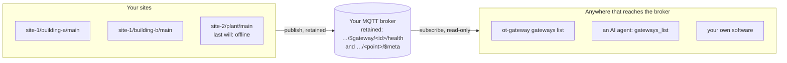

# See your whole fleet from the broker

Every gateway already keeps two kinds of retained messages on its broker: its health and the metadata of each of its points. `ot-gateway gateways` reads them back. So any machine that reaches the broker sees every gateway, which devices fail and why, and every point, with one command and nothing else to run: no database, no central server, no config, no SSH into the sites. An AI agent sees the same through MCP.



## Three commands

```bash
ot-gateway gateways list --broker mqtts://broker.example:8883 --username viewer   # every gateway: online or offline, its devices by status
ot-gateway gateways status site-1/building-b/main --broker mqtts://broker.example:8883 --username viewer   # one gateway: each device and why it fails, its machine
ot-gateway gateways points site-1/building-b/main --broker mqtts://broker.example:8883 --username viewer   # its points from their retained $meta: name, unit, writable
```

`gateways list` prints one line per gateway:

```text
3 gateways on mqtts://broker.example:8883
  site-1/building-a/main  online      3 devices: 3 ok, up since 08:12:40, heartbeat 21 s ago
  site-1/building-b/main  online      2 devices: 1 ok, 1 failing, up since 08:12:44, heartbeat 9 s ago
  site-2/plant/main       offline     connection-lost
```

`gateways status` gives one of them device by device, with its machine, and exits with 1 when it is offline or a device fails:

```text
site-1/building-b/main  online      2 devices: 1 ok, 1 failing, up since 08:12:44, heartbeat 9 s ago
  MQTT contract 1.0
  host: memory 139 MB, event-loop lag 5 ms, disk free 6012 MB, 52 °C
  energy-meter  ok, last read 4 s ago
  heat-pump     failing since 10:41:07 (timeout), last read 12 min ago
```

`gateways points` lists what it publishes:

```text
site-1/building-b/main: 3 points on 2 devices
  energy-meter/active-power  Active power  [unit:KiloW]
  heat-pump/flow-temp        Flow temperature  [unit:DEG_C]
  heat-pump/setpoint         Room setpoint  [unit:DEG_C]  writable
```

With more than 10 devices or 20 points, a terminal lists only the failing devices and the writable points, the first few, and `--all` lists every one; a pipe and `--json` always do.

`offline` comes with its reason: `shutdown` after a clean stop, or `connection-lost` when the broker sent the gateway's last will because the gateway, its machine or its network went away. Add `--json` to any of them for the same in JSON ([what each field is](operations.md#every-gateway-on-a-broker)).

## Why it needs nothing else

The topics are the source of truth. A gateway publishes its health retained on `site/building/$gateway/<id>/health` when it connects, every minute and within a second of a device changing status, and the broker publishes `offline` for it as its MQTT last will when it disappears. Each point's `$meta` is retained too and names the gateway that owns it. A command that subscribes to `+/+/$gateway/+/health` and `+/+/+/+/$meta` therefore gets the state of the whole fleet in one round trip, from the broker alone. [The MQTT contract](mqtt-contract.md) defines both messages.

That means:

- **No extra service.** Nothing to install, back up or keep up besides the broker you already run.
- **Read-only.** The commands only subscribe. A broker login that may read those two topic filters is enough, so give your laptop, a dashboard or an agent a `viewer` login that cannot publish.
- **Works from anywhere.** Your laptop, a CI job or a server in the cloud, as long as it reaches the broker. Outside a gateway's folder, name the broker with `--broker`; in one, the config's broker is used. With `--username`, the password comes from `OT_GATEWAY_BROKER_PASSWORD` (or `ot-gateway.env`), never from a flag.
- **Honest when stale.** A gateway that lost power cannot report it, but its last will can: it shows `offline` within the broker's keepalive timeout, and `heartbeat … ago` shows when an online one last spoke.

Your own software can read the same topics the same way: [the MQTT contract](mqtt-contract.md) publishes a JSON Schema for each.

## With an AI agent

`ot-gateway mcp` serves the CLI's commands as MCP tools, and `gateways_list`, `gateways_status` and `gateways_points` are three of them. Install the CLI globally and add the server once, for every folder:

```bash
npm i -g ot-gateway
claude mcp add -s user ot-gateway -- ot-gateway mcp   # Claude Code; other MCP clients take the same command
```

Then ask in plain words:

```text
> Which of our gateways on mqtts://broker.example:8883 need attention? Log in as viewer.

  gateways_list    3 gateways: 2 online, 1 offline
  gateways_status  site-1/building-b/main

Two of three need a look:
- site-1/building-b/main is running, but heat-pump has failed since 10:41 with a timeout:
  the device connects and does not answer. Check it is powered and its BACnet settings unchanged.
- site-2/plant/main went offline with connection-lost: the gateway, its machine or its network went away.
  On that machine, ot-gateway status says which.
site-1/building-a/main is fine: 3 of 3 devices ok.
```

Each tool returns the command's `--json`, so the agent reads the same fields you would. The tools take `broker` and `username` (the password still comes from `OT_GATEWAY_BROKER_PASSWORD`), and they only read: nothing in them can change a gateway or a device. [Headless setup](headless.md#as-mcp-tools) lists every tool.

## When it says something else

| Code                | What it means                                                                                                   |
| ------------------- | --------------------------------------------------------------------------------------------------------------- |
| `no-broker`         | No `--broker`, and no config in this folder to take one from.                                                   |
| `subscribe-refused` | The login may not read the health or `$meta` topics: grant read on the two filters.                             |
| `gateway-not-found` | No gateway of that name keeps its health on this broker: `gateways list` shows names.                           |
| `gateway-ambiguous` | Several gateways share that id: name it as `site/building/id`.                                                  |
| `gateway-offline`   | `gateways status`: the gateway stopped (`shutdown`) or went away (`connection-lost`).                           |
| `gateway-unhealthy` | `gateways status`: the gateway runs and a device fails; the report says which and why.                          |
| `health-unreadable` | Its health is not a message this CLI reads: a newer release, or something else publishes there. Update the CLI. |

`ot-gateway explain <code>` says more about each, and [Troubleshooting](troubleshooting.md#codes) lists them all.
