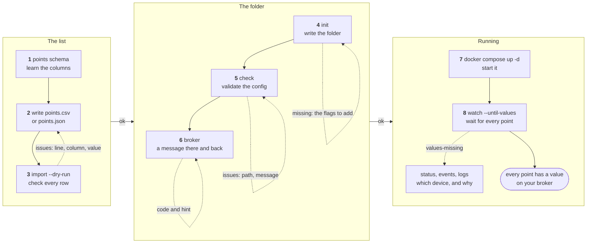
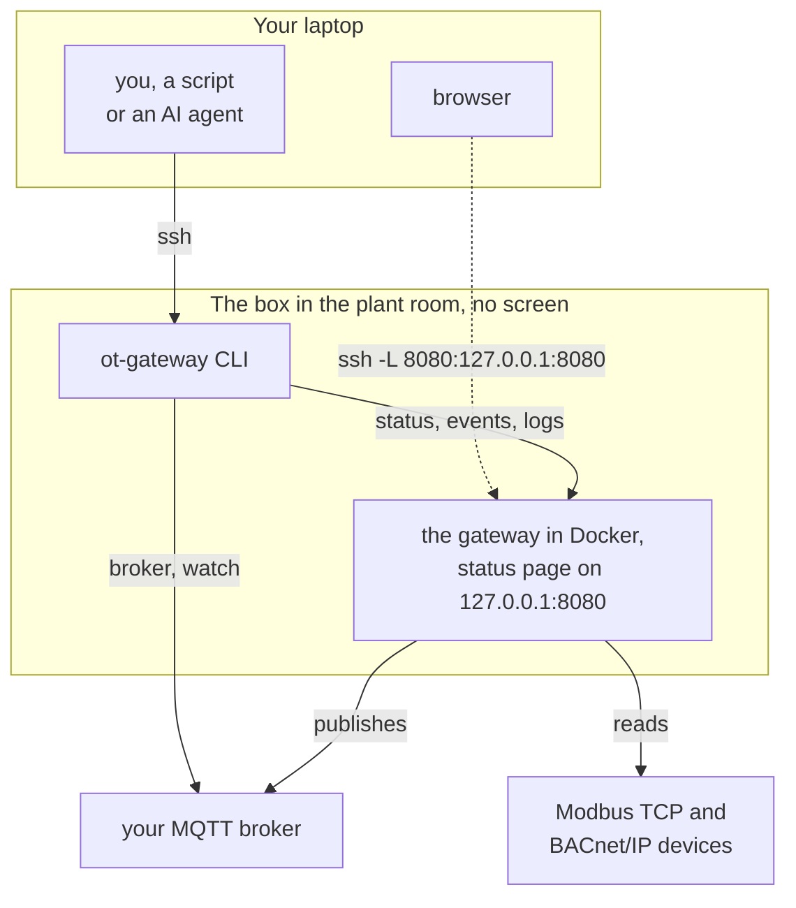
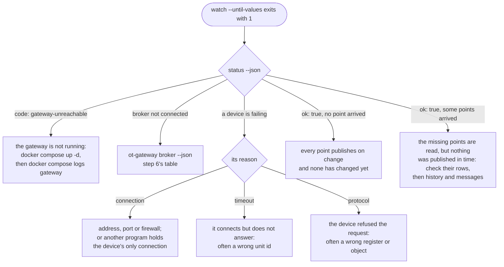

# Headless setup

Set up a gateway without answering a single question: from a script, a CI job, or an AI agent working over SSH on a box with no screen. Every step is one command that prints JSON, says whether it worked through its exit code, and names what to run next.

[Your first building](first-building.md) is the same path with questions and a status page. This page is the one to follow when nobody is at the keyboard.

## The path

Eight commands, in this order. Each one either passes or tells you exactly what to fix, so the whole setup is a loop of run, read, fix, run again.



| Step | Command                                                                 | It passes when                        | When it fails, read             |
| ---- | ----------------------------------------------------------------------- | ------------------------------------- | ------------------------------- |
| 1    | `ot-gateway points schema --json`                                       | always                                |                                 |
| 2    | write `points.csv` or `points.json`                                     |                                       |                                 |
| 3    | `ot-gateway import points.csv --dry-run --json`                         | `ok: true`, exit code 0               | `issues[]`: line, column, value |
| 4    | `ot-gateway init site-1 --site … --broker … --points points.csv --json` | `ok: true`, three files written       | `missing[]` and `hint`          |
| 5    | `ot-gateway check --json`                                               | `ok: true`                            | `issues[]`: path, message       |
| 6    | `ot-gateway broker --json`                                              | `ok: true`, a message there and back  | `code` and `hint`               |
| 7    | `docker compose up -d`                                                  | the container starts                  | `docker compose logs gateway`   |
| 8    | `ot-gateway watch --until-values --json`                                | exit code 0: every point sent a value | `missing[]`, then `status`      |

Against simulated devices the whole path takes about two minutes of commands.

## Three rules every command keeps

1. **Nothing asks.** Without a terminal no command waits for an answer. `init` is the only one with questions, and without a terminal it takes them as flags or stops and names the flags it lacks. A setup never hangs on a prompt nobody sees.
2. **`--json` is the answer, on stdout.** One JSON object with `ok: true` or `ok: false`. A failure is JSON too: `error` in words, `code` to branch on, `hint` with what to check. Progress and logs go to stderr, so `ot-gateway check --json | jq` always parses.
3. **The exit code decides.** `0` it worked, `1` it did not (the JSON says why), `2` the command line itself was wrong (a missing answer, an unknown flag).

The results of `init` and `check` also carry `next`: the commands to run after them, with the right paths filled in. A script can ignore it; an agent can follow it.

```json
{
  "ok": false,
  "path": "ot-gateway.json",
  "error": "could not connect to mqtt://localhost:1884: connection refused by 127.0.0.1:1884",
  "code": "broker-unreachable",
  "hint": "is the broker running and listening there? Check mqtt.url (mqtt://localhost:1884); ot-gateway demo runs a test broker on this machine"
}
```

## Before you start

You need three things on the machine that sits on the building network:

- **The `ot-gateway` command.** With Node.js 22.18 or newer, `npx ot-gateway` (or `pnpm dlx ot-gateway`) runs it with nothing to install; `npm i -g ot-gateway` or `pnpm add -g ot-gateway` keeps it installed. On a box with Docker and no Node (a Raspberry Pi), [one line installs a wrapper](operations.md#docker-compose-recommended) that runs the same CLI from the gateway's image. In a checkout it is `pnpm ot-gateway`. The examples below write `ot-gateway`.
- **Docker with Compose 2.24 or newer**, to keep the gateway running. Step 7 has the alternative without Docker.
- **A broker URL**, `mqtt://host:1883` or `mqtts://host:8883` for TLS, and its username if it has one. The password never goes on a command line or into the config: step 4 says where it goes.

Where everything runs, when you work from a laptop over SSH:



`check` and `import --dry-run` connect to nothing, so they are safe to run anywhere, as often as you like. `broker` and `watch` talk to the broker. `status`, `events`, `logs`, `history` and `messages` ask the running gateway on its status port.

## 1. Learn the points list

The points list is the one input: a row per value you want, with the device it comes from. The CLI describes its own format, so a script or an agent never has to guess or read this page for it:

```bash
ot-gateway points schema --json          # every column: name, required, default, allowed values
ot-gateway points schema --brief --json  # the same in short
ot-gateway points schema --json-schema   # the JSON Schema of the list as JSON
ot-gateway points template               # a CSV with every column and example rows (--protocol modbus or bacnet: only its columns)
ot-gateway profiles list --json          # Modbus models whose registers a row can take by name
```

`points template --json` and `points from-ede <file> --json` give the list as `csv` inside a JSON result, and `import - --text='<the list>'` (and `points from-ede - --text=…`) takes a list as text in place of a file, for an agent that cannot write files. `OT_GATEWAY_JSON` leaves `points template` and `points from-ede` as they are, so a list redirected into a file stays a list.

A row with a `host` is Modbus TCP, a row with a `device_instance` is BACnet/IP, and one list can hold both. Rows with the same `device` are one device. [What the gateway needs from you](inputs.md) explains every field.

## 2. Write the list

As CSV, which a person can open in a spreadsheet:

```csv
device,point,unit,interval_s,host,register,table,type,device_instance,object_type,object_instance
Energy meter,Active power,kW,5,192.168.1.50,100,holding,float32,,,
Energy meter,Energy,kWh,5,192.168.1.50,0,input,uint32,,,
Heat pump,Flow temperature,°C,30,,,,,2001,analog-input,1
Heat pump,Compressor running,,30,,,,,2001,binary-input,1
```

Or the same columns as JSON, which a program writes without CSV's quoting traps:

```json
[
  {
    "device": "Energy meter",
    "point": "Active power",
    "unit": "kW",
    "host": "192.168.1.50",
    "register": 100,
    "type": "float32"
  },
  {
    "device": "Heat pump",
    "point": "Flow temperature",
    "unit": "°C",
    "device_instance": 2001,
    "object_type": "analog-input",
    "object_instance": 1
  }
]
```

You do not always have to write it by hand:

| What you have                                  | How it becomes a points list                                                                                                                                                                                                                                   |
| ---------------------------------------------- | -------------------------------------------------------------------------------------------------------------------------------------------------------------------------------------------------------------------------------------------------------------- |
| BACnet devices on the network                  | `init … --devices discover` in step 4 finds them and needs no list. To trim the draft first: `ot-gateway discover --points-list points.csv` (no config needed), delete rows, then step 3 with that list                                                        |
| Modbus TCP devices at addresses you don't know | `ot-gateway discover modbus 192.168.1.0/24 --points-list modbus.csv --json` (read-only, rate-limited; `--unit-ids 1-247` behind a Modbus gateway) writes one placeholder row per unit: replace each with the datasheet's registers, then step 3 with that list |
| A BACnet EDE file                              | `import` and `init --points` read it as it is                                                                                                                                                                                                                  |
| A Modbus device with a known profile           | one row with `profile` and `point` `*` takes all its registers                                                                                                                                                                                                 |
| A Modbus register you are unsure of            | `ot-gateway probe <host> <register> --json` reads it once and returns a row to copy                                                                                                                                                                            |
| A PDF, a spreadsheet, anything else            | an AI agent translates it into these columns; step 3 checks its work                                                                                                                                                                                           |

No list makes a point writable. A point takes commands only after `ot-gateway points allow-commands <device/point>` (with `--min` and `--max` for a number), one point at a time, on purpose: run it when the person names the point and its limits, never to try something out. `--dry-run --json` checks it first, `points read-only` undoes it, and the running gateway takes either with `restart`.

## 3. Check the list

```bash
ot-gateway import points.csv --dry-run --json
```

It reads the list, connects to nothing and writes nothing. Every mistake comes back at once, each with its line, its column and the value found there, so one pass fixes them all:

```json
{
  "ok": false,
  "issues": [
    {
      "line": 2,
      "column": "type",
      "value": "float23",
      "message": "type \"float23\": Expected \"int16\" | \"uint16\" | \"int32\" | \"uint32\" | \"float32\" | \"int64\" | \"uint64\" | \"float64\" | \"bool\""
    },
    {
      "line": 5,
      "column": "object_type",
      "value": "binary-input",
      "message": "\"Compressor running\" needs object_type and object_instance (analog-input 1, say)"
    }
  ]
}
```

Fix the rows and run it again until `ok` is `true`. A clean list comes back as the devices it would create, plus two things worth a look before you go on:

- `units`: each unit as you wrote it and the standard QUDT name it becomes (`kW` is `unit:KiloW`). A unit that looks like a typo is kept as written and gets a `suggestion`, so `kWhh` is caught here and not by whoever reads the broker.
- `summary`: per device, how many points, how often they are read, and how many are writable (0, always, from a list).

## 4. Write the folder

`init` takes its answers as flags and writes the gateway's folder: `ot-gateway.json` (the config), `compose.yaml` (how Docker runs it) and `ot-gateway.env` (secrets).

```bash
ot-gateway init site-1 --json \
  --site site-1 \
  --broker mqtts://broker.example:8883 --username gateway \
  --points points.csv
```

| Flag                           | What it sets                                                                                           |
| ------------------------------ | ------------------------------------------------------------------------------------------------------ |
| `site-1` (the argument)        | the folder, created if missing; `.` for the current one                                                |
| `--site`, `--building`         | the first two parts of every topic: `site-1/main/energy-meter/active-power`                            |
| `--broker`                     | the broker's URL                                                                                       |
| `--username`, `--password-env` | the broker login; the password's variable name, `MQTT_PASSWORD` unless you say otherwise               |
| `--points`                     | the points list from step 3                                                                            |
| `--devices`                    | instead of a list: `simulated`, `discover` (find BACnet devices now) or `none`                         |
| `--status-port`                | the status page's port, when another program has 8080                                                  |
| `--dry-run`                    | show the config and the files, write nothing                                                           |
| `--yes`                        | take the default for whatever no flag gives: site `my-site`, a broker on localhost, a simulated device |
| `--force`                      | replace a config that exists; without it `init` refuses and keeps yours                                |

The password is the one thing `init` does not take. With a `--username` it writes an empty `MQTT_PASSWORD=` line into `ot-gateway.env`, and the result's `notes` say so. Fill that line in with an editor. A script writes it from wherever it keeps its secrets, so that the password is never typed on a command line:

```bash
# BROKER_PASSWORD comes from your secret store, not from the keyboard
env=site-1/ot-gateway.env
grep -v '^MQTT_PASSWORD=' "$env" > "$env.new"
printf "MQTT_PASSWORD='%s'\n" "$BROKER_PASSWORD" >> "$env.new"   # printf is part of the shell: nothing shows in ps
chmod 600 "$env.new" && mv "$env.new" "$env"
```

The single quotes keep a password with spaces or a `#` whole. A password that itself contains a single quote goes in double quotes instead.

`ot-gateway.env` is readable by you alone; keep it out of git. Docker Compose and every `ot-gateway` command read it from the folder.

Run without a terminal and without its answers, `init` writes nothing, exits with 2 and says which flags it lacks, with a full command to copy:

```json
{
  "ok": false,
  "error": "no terminal to ask, so init needs its answers as flags: --site, --broker, --points <list> or --devices simulated|discover|none; or --yes for the defaults (site my-site, a broker on localhost, a simulated device). Nothing was written",
  "code": "missing-answers",
  "missing": ["--site", "--broker", "--points <list> or --devices simulated|discover|none"],
  "hint": "ot-gateway init site-1 --site site-1 --broker mqtts://broker.example:8883 --points points.csv"
}
```

The commands from here on run in the folder (`cd site-1`), where they find `ot-gateway.json` by themselves. From elsewhere, name the config: `ot-gateway check site-1/ot-gateway.json`.

## 5. Check the config

```bash
ot-gateway check --json
```

`init` has checked what it wrote, so this step is for every edit after it. `check` connects to nothing and lists every mistake with its `path` in the file:

```json
{
  "ok": false,
  "code": "invalid-config",
  "issues": [
    {
      "path": "site",
      "message": "Expected a slug: lowercase letters, digits, - and _, starting with a letter or digit (site-1, not Site 1)"
    },
    { "path": "devices.0.pollIntervalMs", "message": "Expected number" }
  ]
}
```

A valid config answers with the gateway it describes (site, broker, each device with how it is read) and `next`. The [configuration reference](configuration.md) has every key.

## 6. Check the broker

```bash
ot-gateway broker --json
```

It logs in as the gateway will, sends one message and waits for it to come back, so a wrong URL, a wrong password or a missing permission shows now and not as an empty broker later:

```json
{
  "ok": true,
  "broker": "mqtt://localhost:1883",
  "protocolVersion": "5",
  "maximumQoS": 1,
  "retainAvailable": true,
  "roundTripMs": 48,
  "warnings": []
}
```

| `code`                 | What happened                                                      | What to do                                                                                      |
| ---------------------- | ------------------------------------------------------------------ | ----------------------------------------------------------------------------------------------- |
| `broker-unreachable`   | nothing accepts a connection there                                 | check `mqtt.url`, and that the broker runs                                                      |
| `broker-timeout`       | something is in the way, or answers other than MQTT                | a firewall, the wrong port, or TLS on one side only (`mqtts://`, 8883)                          |
| `broker-login-refused` | the broker refused the username or password                        | check `mqtt.username` and the password in `ot-gateway.env`                                      |
| `broker-refused`       | the broker refused for another reason, which it names              | read `hint`: it carries the broker's own words                                                  |
| `no-round-trip`        | connected, but the message did not come back; `warnings[]` says so | the broker's access rules must allow this user to publish and subscribe under `site/building/#` |
| `password-unset`       | the config names a password variable that has no value             | put the password in `ot-gateway.env`; nothing was sent                                          |

## 7. Run it

```bash
docker compose up -d
```

Compose pulls the image, starts the gateway, restarts it after a crash or a reboot and keeps its logs. That is the whole install; [Running a gateway](operations.md) covers upgrades and backups.

Without Docker, `ot-gateway run` runs the same gateway in the foreground until the terminal closes: fine for a first try on a laptop, not for a plant room. [systemd](operations.md#systemd-without-docker) is the way to keep it running there.

The gateway keeps reading while the broker is away and sends what it stored once the broker is back, so a broker that is not ready yet is no reason to wait with this step.

## 8. Confirm values arrive

```bash
ot-gateway watch --until-values --json
```

This is the test that the setup is done. It subscribes at your broker, prints every message as one JSON line, and stops as soon as every point in the config has sent a value: exit code 0. Its last line is then the summary:

```json
{
  "event": "summary",
  "seconds": 4,
  "messages": 10,
  "points": 4,
  "arrived": 4,
  "missing": 0,
  "devices": [
    { "id": "energy-meter", "arrived": ["active-power", "energy"], "missing": [], "onChange": [] },
    { "id": "heat-pump", "arrived": ["flow-temperature", "compressor-running"], "missing": [], "onChange": [] }
  ]
}
```

When a point stays silent it waits for the slowest poll interval plus 30 seconds (at least 60 seconds, or `--seconds N`), then exits with 1. After the summary line comes one more line, the failure, that names the points (spread out here to read). Once the watch has started, every line it prints is one JSON object, to the end, so `tail -n 1` is the outcome:

```json
{
  "ok": false,
  "error": "2 of 4 points sent no value within 60 s",
  "code": "values-missing",
  "missing": ["energy-meter/active-power", "energy-meter/energy"],
  "hint": "ot-gateway status says why a device fails (it must be running: ot-gateway run, or docker compose up -d); a point that never changes and publishes on change only sends its first value at start"
}
```

A point that publishes only on change and has not changed since the watch began is listed under `onChange`, not under `missing`: it is not a failure, as long as at least one point sent a value. When nothing arrived at all, the watch fails and names those points too, since nothing shows that the gateway works.

What the messages look like (topics, the value payload, the retained `$meta` and health messages) is the [MQTT contract](mqtt-contract.md), with a JSON Schema for each message. The CLI prints it, with no config and no broker:

```bash
ot-gateway contract --json          # {ok, version, url, topics[], schemas}: every topic and each message's JSON Schema
ot-gateway contract value --json    # one message's JSON Schema alone, to hand to a validator
ot-gateway watch --check --seconds 60 --json
```

`watch --check` checks every message under the site and building against the contract, with the same strict check as the gateway's own tests, and prints only the ones off it, each with `contract: {message, issues[]}` next to the message. After the usual `{"event":"summary"}` line (when the config has points) comes `{"event":"contract","version":"1.0","checked":120,"off":0}`, and then, when one was off, a failure with `code: off-contract`. A check that saw no message under the site and building fails with `code: nothing-checked`, since that proves nothing. With `--until-values` as well, missing values keep the code `values-missing` and the `error` adds the messages off the contract. Use it when a consumer chokes on something: it tells whether the gateway or another publisher sent it.

## When something fails

Not sure where it breaks? `doctor` runs every check of the path at once and puts the failures first in `next`:

```bash
ot-gateway doctor --json   # config, broker, gateway, each device, BACnet/IP port, disk, clock
```

Each of its `findings` has a `check`, a `status` (`ok`, `warn`, `fail` or `skip`) and, when it is not `ok`, the same `code` and `hint` the command behind that check reports, and `next`, the command to look closer. It exits with 1 when one fails. With the gateway running, the devices are its own view of them; without it, each device is asked once, read-only.

`watch` says that values are missing. These three say why, each from the running gateway:

```bash
ot-gateway status --json              # now: each device, ok or failing, and why
ot-gateway events --since 1h --json   # before: what broke, and when it came back
ot-gateway logs --level warn --json   # in detail: the warnings and errors
```

`status` exits with 1 while anything is wrong and says it in one line, `problem`. A failing device carries its `lastError`, a `reason`, and `hints` with what the error means and what to check, most likely first:

```json
{
  "ok": false,
  "problem": "1 of 2 devices failing",
  "devices": [
    {
      "id": "energy-meter",
      "status": "failing",
      "reason": "connection",
      "lastError": "could not connect: connection refused by 192.168.1.50:502",
      "hints": {
        "meaning": "The address answers, but nothing accepts a connection on that port.",
        "checks": [
          "Is the device switched on and its Modbus TCP server (or its network module) enabled?",
          "Are the host and port in the config right? Modbus TCP is usually port 502.",
          "Is a firewall or a VLAN between the gateway and the device blocking the port?"
        ]
      }
    }
  ]
}
```

Start from the symptom:



| What you see                                                   | Where                      | What it means                                                         | Next                                                                  |
| -------------------------------------------------------------- | -------------------------- | --------------------------------------------------------------------- | --------------------------------------------------------------------- |
| `code: missing-answers`, exit code 2                           | `init`                     | no terminal and not enough flags                                      | run the command in `hint`                                             |
| `code: usage`, exit code 2                                     | any command                | an unknown flag or a missing argument                                 | `hint` names the `--help` to read                                     |
| `code: no-config`                                              | any command with a config  | no `ot-gateway.json` here                                             | `cd` into the folder, or name the config                              |
| `issues[]` with `line`                                         | `import`, `init --points`  | mistakes in the points list                                           | fix those rows, run it again                                          |
| `code: invalid-config`                                         | `check`                    | mistakes in `ot-gateway.json`                                         | fix each `path`, run it again                                         |
| `code: password-unset` (`run` logs `MQTT_PASSWORD is not set`) | `broker`, `watch`, `run`   | the config names a password variable that has no value                | put it in `ot-gateway.env`                                            |
| `code: broker-…`, or `ok: false` with `warnings`               | `broker`, `watch`          | the broker cannot be reached, refuses, or does not return the message | step 6's table                                                        |
| `code: values-missing`                                         | `watch --until-values`     | some points sent nothing in time                                      | `ot-gateway status --json`                                            |
| `code: off-contract`                                           | `watch --check`            | a message under the site and building is not what the contract says   | its `contract.issues[]`; `ot-gateway contract <message>`              |
| `code: nothing-checked`                                        | `watch --check`            | no message under the site and building arrived to check               | `ot-gateway status --json`                                            |
| `code: gateway-unreachable`                                    | `status`, `events`, `logs` | no gateway answers on the status port                                 | start it; `docker compose logs gateway` when it does not stay up      |
| a device `failing`                                             | `status`                   | the device does not answer as configured                              | follow its `hints.checks`, then [Troubleshooting](troubleshooting.md) |

Two cases are worth knowing before they cost you time:

- **`status` with no gateway running** fails with `gateway-unreachable`, not with an empty list. After `docker compose up -d` that means the container stopped again: `docker compose logs gateway` shows its last lines.
- **A BACnet port that is taken.** BACnet/IP uses UDP port 47808, and only one program on a machine can have it. While the gateway runs, `discover` cannot use the port too. It says that another program holds the port, not that the network is silent, and gives both ways out: stop the gateway for the scan, or set `bacnet.port` to a free one.

## The whole path as a script

Everything above, for a machine with `jq`. It stops at the first step that fails and prints what that step said to fix. Each step's full answer stays in a file next to it. `init` keeps a config that exists, so a second run needs a new folder or `--force`.

```bash
#!/usr/bin/env bash
set -euo pipefail

site=site-1
broker=mqtt://192.168.1.10:1883

# 3. the list, row by row
ot-gateway import points.csv --dry-run --json > import.json \
  || { jq '.issues' import.json; exit 1; }

# 4. the folder
ot-gateway init "$site" --site "$site" --broker "$broker" --points points.csv --json > init.json \
  || { jq '{code, error, missing, hint}' init.json; exit 1; }
cd "$site"

# 5 and 6. the config, then the broker
ot-gateway check --json > check.json   || { jq '.issues' check.json; exit 1; }
ot-gateway broker --json > broker.json || { jq '{code, error, hint, warnings}' broker.json; exit 1; }

# 7. run it
docker compose up -d

# 8. done when every point has a value on the broker
if ot-gateway watch --until-values --json > watch.ndjson; then
  echo "every point has a value on the broker"
else
  tail -n 1 watch.ndjson | jq '{code, missing, hint}'
  ot-gateway status --json \
    | jq '{code, error, hint, problem, devices: [.devices[]? | select(.status != "ok") | {id, lastError, hints}]}'
  exit 1
fi
```

## With an AI agent

An agent follows the same eight steps, and reads this page better as Markdown: every docs page is also served with `.md` added to its URL, and [`/llms.txt`](https://ot-gateway.vercel.app/llms.txt) indexes them.

With any agent that can run commands, paste:

```text
Set up an OT Gateway for my site with npx ot-gateway, without asking me anything you can find out.
Read https://ot-gateway.vercel.app/docs/headless.md and follow its eight steps: learn the points list
from `points schema --json`, translate my list into it, check it with `import --dry-run --json` until
it is clean, write the folder with `init --json`, then `check`, `broker`, `docker compose up -d` and
`watch --until-values --json`. Read each command's JSON and its exit code, and follow `hint` when a command fails.
Never make a point writable unless I name it and its limits, and keep the broker password in ot-gateway.env only.
```

In Claude Code, the `/setup` skill does the same with more care for the edges ([Set it up with AI](../README.md#set-it-up-with-ai)). To have an agent reach for the CLI in later sessions, add one line to its instructions (`AGENTS.md`, `CLAUDE.md`):

```text
For OT Gateway configs, points lists and folders, use `npx ot-gateway`; start with `npx ot-gateway --help`.
```

### As MCP tools

An agent that does not run a shell (a desktop chat app, an IDE assistant) reaches the same commands through `ot-gateway mcp`, a Model Context Protocol server on stdio. Start it in the gateway's folder, so `ot-gateway.json` is found as it is for the CLI:

```bash
claude mcp add ot-gateway -- npx ot-gateway mcp   # Claude Code; other clients take the same command
claude mcp add -s user ot-gateway -- ot-gateway mcp   # installed globally (npm i -g ot-gateway, or pnpm add -g ot-gateway): in every folder, for the gateways_* tools
```

It also serves the setup guide (the steps from nothing to a running gateway, the same as Claude Code's `/setup`): as the `setup` prompt (`prompts/get`), which a client offers as a slash command, and as the `setup_guide` tool, for a client that has no prompts. `ot-gateway guide setup` prints it in a shell. So an agent set up with only `ot-gateway mcp` needs no checkout and no link.

Each tool is a command with `--json`, and its result is that command's JSON (as `structuredContent` too when it is one object), `isError` when the command exits with 1 or 2: `check`, `doctor`, `broker`, `gateways_list`, `gateways_status`, `gateways_points` (every gateway on a broker, from its retained health and `$meta`: `broker` names one, so they work outside a gateway's folder too, [See your whole fleet](fleet.md)), `status`, `events`, `logs`, `history`, `messages`, `read`, `write`, `watch` (for `seconds`, 1 to 300), `discover`, `discover_save` (`discover --save all` or `--save <ids>`: the found devices into the config; `dryRun` unless told otherwise), `discover_modbus` (its rows come back in the JSON; no file is written), `probe`, `import` (`dryRun` unless told otherwise; the list as a file, as `text` or as `rows`, so no file has to be written first), `points_schema`, `report_draft` and `report_send` (a bug in ot-gateway as a public issue: the draft with names and addresses replaced, filed only with `confirmed: true` after the user has read it), `points_template` and `points_from_ede` (the list as `csv` in the result; no file is written), `init` (the folder's files without a question; `dryRun` unless told otherwise, and no argument takes a password), `secret_list` (which secrets are set, by name only), `clear_retained` (an empty retained message on one topic, for what `diff` lists as stale), `points_allow_commands` (one point takes commands; `dryRun` unless told otherwise, and only when the person named the point and its limits), `points_read_only`, `config_get`, `config_set` (one key by its path, or `unset`; `dryRun` unless told otherwise; never a point's `writable` or `limits`), `config_remove` (a device or a point; `dryRun` unless told otherwise), `config_undo` (the previous file back; `dryRun` unless told otherwise), `contract`, `profiles_list`, `profiles_show`, `explain`, `support` (the report as text, no file written), `up`, `restart`, `down` and `upgrade` (`check` only compares), `start` and `stop` (the gateway in the background on this machine, the way on macOS), and `setup_guide`. Their arguments are the command's flags in camelCase (`failOnAlarm`, `untilValues`, `unitId`); `tools/list` gives each one's JSON Schema. An argument the tool does not know, or one that starts with `-`, is refused with `code: "usage"`, so no argument becomes a flag. `up`, `restart`, `down` and `upgrade` run Docker Compose on the gateway's machine (Linux), as the commands do. `points_allow_commands`, `points_read_only`, `config_set`, `config_remove` and `config_undo` change the config file, never a device, and the running gateway takes the change with `restart`. `write` is the one tool that changes a device, and it goes through the running gateway's command guard as `ot-gateway write` does: writable points only, within their limits, always logged. Commands that run until stopped (`run`, `demo`, `simulate`) are not tools. Neither is `secret set`: the person types a secret into the command themselves, so it never passes through the agent's conversation. Of `publish` only `clear_retained` is one, because a message of an agent's own on the gateway's topics could pass for a value. A call runs at most 15 minutes, its wait for a turn included, four at a time (`import`, `init`, `clear_retained`, `write`, `points_allow_commands`, `points_read_only`, `config_set`, `config_remove`, `config_undo`, `up`, `restart`, `down` and `upgrade` one at a time), and a call the client cancels is stopped.

## Reference: what `--json` returns

Every result that can fail has `ok`. `status`, `events`, `logs`, `history` and `messages` give each time twice: as Unix milliseconds and, under the same key with `Local` added, in the machine's local time with its UTC offset. A `watch` line's `at` is an ISO time in UTC.

| Command                         | On success                                                                                               | On failure                                                      |
| ------------------------------- | -------------------------------------------------------------------------------------------------------- | --------------------------------------------------------------- |
| `points schema --json`          | `format`, `version`, `rules`, `columns[]`                                                                |                                                                 |
| `import --dry-run --json`       | `points`, `units[]`, `devices[]`, `summary[]`                                                            | `issues[]`: `line`, `column`, `value`, `message`                |
| `init --json`                   | `files.written`, `notes[]`, `next[]`, `url`; with `--dry-run`, `files.wouldWrite` and the whole `config` | `code`, `missing[]`, `hint`                                     |
| `check --json`                  | `site`, `building`, `broker`, `devices[]`, `warnings[]`, `next[]`                                        | `code`, `issues[]`: `path`, `message`                           |
| `broker --json`                 | `protocolVersion`, `maximumQoS`, `retainAvailable`, `roundTripMs`                                        | `code`, `hint`; or the report with `ok: false` and `warnings[]` |
| `gateways list --json`          | `broker`, `gateways[]`: `name`, `status`, `since`, `ts`, `devices[]`, `host`                             | `code`, `hint`                                                  |
| `watch --json`                  | one line per message: `at`, `topic`, `retained`, `payload`; then `{"event":"summary"}`                   | `code`, `missing[]`, `hint`                                     |
| `watch --check --json`          | one line per message off the contract, with `contract`; then the summary and `{"event":"contract"}`      | `code: off-contract` or `nothing-checked`, `hint`               |
| `contract --json`               | `version`, `url`, `topics[]`, `schemas` (one JSON Schema per message)                                    |                                                                 |
| `status --json`                 | `broker`, `buffer`, `host`, `devices[]` with `points[]`                                                  | the same, with `problem` and per device `hints`                 |
| `events --json`                 | `events[]`: `at`, `type`, and what happened                                                              | `code`, `hint`                                                  |
| `logs --json`                   | `lines[]`: the recent log lines, secrets redacted                                                        | `code`, `hint`                                                  |
| `history <device/point> --json` | `series[]` with `buckets[]`: `min`, `max`, `avg`, and the gaps                                           | `code`, `hint`                                                  |

`ot-gateway --help` lists every command, and `ot-gateway <command> --help` its flags with examples.
