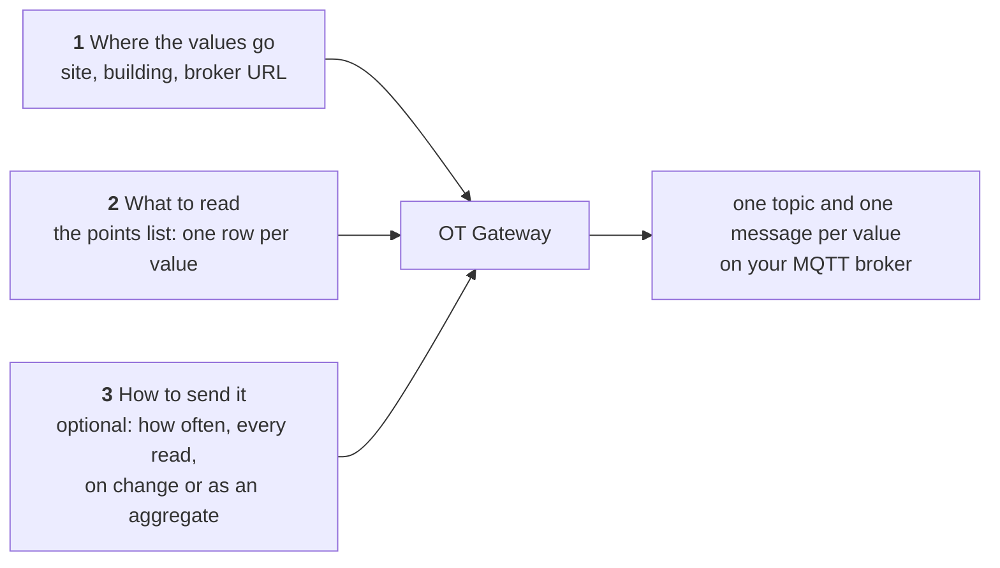
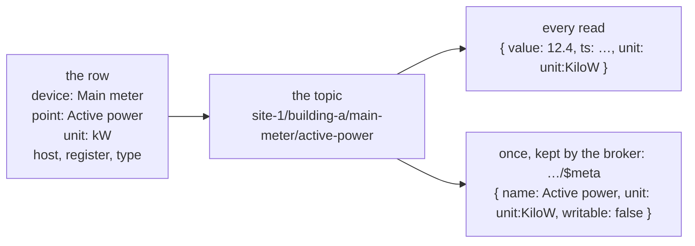

# What the gateway needs from you

Three things, and nothing else: where your values should go, which values to read, and how often to send them. Everything else has a default. This page shows each one in its smallest form and what it turns into on your broker.



## 1. Where the values go

Three answers, given once:

| You give   | Example                       | What it is for                                               |
| ---------- | ----------------------------- | ------------------------------------------------------------ |
| a site     | `site-1`                      | the first part of every topic: a campus, a plant, a property |
| a building | `building-a`                  | the second part: a building or hall on that site             |
| a broker   | `mqtts://broker.example:8883` | where the values are sent; a username if the broker has one  |

Site and building are short names in lowercase letters, digits and dashes, because they become part of every topic. The broker's password is never part of any of this: it lives in `ot-gateway.env`, next to the config.

## 2. What to read: the points list

The points list has one row per value you want. This is the smallest list that works, with one Modbus value and one BACnet value:

```json
[
  {
    "device": "Main meter",
    "point": "Active power",
    "host": "192.168.1.50",
    "register": 100,
    "type": "float32"
  },
  {
    "device": "Heat pump",
    "point": "Flow temperature",
    "device_instance": 2001,
    "object_type": "analog-input",
    "object_instance": 1
  }
]
```

The same list as CSV, for a spreadsheet:

```csv
device,point,host,register,type,device_instance,object_type,object_instance
Main meter,Active power,192.168.1.50,100,float32,,,
Heat pump,Flow temperature,,,,2001,analog-input,1
```

Every row answers the same three questions: which value is it, where is the device, and which value inside the device. The first answer is the same for every row: `device` and `point`, two names you choose. Rows with the same `device` are one device. The other two depend on the protocol, so a row is either a Modbus row or a BACnet row, and each kind has only its own fields. One list can hold both kinds.

### A Modbus TCP row

```json
{
  "device": "Main meter",
  "point": "Active power",
  "host": "192.168.1.50",
  "register": 100,
  "type": "float32"
}
```

| Field        | Needed          | What it is                                                                                            |
| ------------ | --------------- | ----------------------------------------------------------------------------------------------------- |
| `host`       | yes             | the device's IP address. A row with a `host` is a Modbus row                                          |
| `register`   | yes             | the register's address, counted from 0: a manual's 40101 is usually 100                               |
| `type`       | yes             | how the number is stored: `float32`, `uint16`, `int32`, …                                             |
| `table`      | default holding | `holding`, `input`, `coil` or `discrete`. A coil or a discrete input is on or off and needs no `type` |
| `port`       | default 502     | the TCP port                                                                                          |
| `unit_id`    | default 1       | the Modbus unit id, for a device behind a Modbus gateway                                              |
| `byte_order` | default ABCD    | the order of the bytes in a value wider than one register                                             |

`register` and `type` come from the register map in the device's manual. Not sure of one? `ot-gateway probe 192.168.1.50 100` reads the register once and shows what every type and byte order would give, so you can pick the one that matches the device's display. For a device with a profile (`ot-gateway profiles list`), one row with a `profile` and `"point": "*"` takes all its registers, and you look nothing up.

### A BACnet/IP row

```json
{
  "device": "Heat pump",
  "point": "Flow temperature",
  "device_instance": 2001,
  "object_type": "analog-input",
  "object_instance": 1
}
```

| Field             | Needed | What it is                                                                                  |
| ----------------- | ------ | ------------------------------------------------------------------------------------------- |
| `device_instance` | yes    | the device's number on the BACnet network. A row with one is a BACnet row                   |
| `object_type`     | yes    | the kind of object: `analog-input`, `binary-value`, `multi-state-input`, …                  |
| `object_instance` | yes    | the object's number within its type                                                         |
| `address`         | no     | the device's IP address (`ip` or `ip:port`), only when the gateway cannot find it by itself |

You rarely write BACnet rows by hand. BACnet devices describe themselves, so the gateway finds them and drafts their rows, with names and units: "Find BACnet devices" in the status page, or `ot-gateway discover --points-list points.csv`. An EDE file from an engineering tool is read as a points list as it is.

### What one row becomes

A row is one value, and one value is one topic with one kind of message. The names you chose are the topic:



- **The topic** is `site/building/device/point`. `Main meter` becomes `main-meter`: lowercase, with dashes.
- **The value message** arrives on that topic: the number as the device means it, the time it was read, and the unit.
- **The `$meta` message** describes the point once and is kept by the broker, so a dashboard that connects later still learns the name and the unit.

## 3. How to send it

All of this is optional. Add a column only where the default is not what you want.

| You want                                  | Add to the row                               | What changes on the broker                                |
| ----------------------------------------- | -------------------------------------------- | --------------------------------------------------------- |
| a unit on the value                       | `"unit": "kW"`                               | the message and `$meta` carry it, as a standard QUDT name |
| a display name other than the point       | `"name": "Main meter power"`                 | `$meta` and the status page show it                       |
| to read more or less often than every 5 s | `"interval_s": 30`                           | one read every 30 seconds, for the whole device           |
| every read sent (the default)             | nothing, or `"publish": "sample"`            | one message per read                                      |
| a message only when the value changes     | `"publish": "change"`, `"deadband": 0.2`     | nothing while it stays within 0.2 of the last value sent  |
| one summary per 15 minutes                | `"publish": "aggregate"`, `"publish_s": 900` | one message per window with `min`, `max`, `avg`, `last`   |
| the device's raw number converted         | `"scale": 0.1`, `"offset": 0`                | value = raw × scale + offset                              |
| the point treated as an alarm             | `"alarm": "on"`                              | the status page and events raise it while the value is on |

A fuller row, then, for an energy counter that reports in tenths of a kWh and should arrive as one message per quarter of an hour:

```json
{
  "device": "Main meter",
  "point": "Energy",
  "unit": "kWh",
  "host": "192.168.1.50",
  "register": 102,
  "type": "uint32",
  "scale": 0.1,
  "publish": "aggregate",
  "publish_s": 900
}
```

`ot-gateway points schema` prints every column with its default and allowed values, and `ot-gateway points template` a list to fill in.

## What you never have to give

- **Anything writable.** No list makes a point writable. The gateway only reads until you allow a command on one point, on purpose, with limits.
- **Ports and ids with a usual value.** Modbus port 502, unit id 1, the holding register table, byte order ABCD, BACnet port 47808.
- **Where data is kept.** The outbox that holds values while the broker is away, and the history behind the status page's charts, are set up for you.
- **Topics.** They follow from the names. There is no topic to type and none to get wrong.

## Three ways to hand it over

The same three things go in whichever way suits you, and end up in the same place: `ot-gateway.json`, the gateway's config.

| Way                 | Where the values go                         | What to read                                                                                                                             |
| ------------------- | ------------------------------------------- | ---------------------------------------------------------------------------------------------------------------------------------------- |
| **The status page** | the Settings tab: Gateway and Broker        | Add a device and its points in a form, find BACnet devices, or upload the points list. Each point can be tested before anything is saved |
| **The CLI**         | `ot-gateway init`, as questions or as flags | `init --points points.json`, or `ot-gateway import points.json`                                                                          |
| **An AI agent**     | it asks you, then runs the CLI              | it turns your spreadsheet or data sheet into the points list                                                                             |

A list uploaded in the status page is applied at once. After `ot-gateway import` on the command line, restart the gateway (`docker compose restart`) so it reads the new config.

[Your first building](first-building.md) walks the questions and the status page; [Headless setup](headless.md) is the same without a single question, for scripts and agents.

### One thing, three names

The points list, the status page and the config file describe the same settings, each in the words that fit its form. When you move between them, this is the map:

| Points list column                 | Status page field            | Config key (`ot-gateway.json`)                     |
| ---------------------------------- | ---------------------------- | -------------------------------------------------- |
| `device`                           | Id                           | `id` of the device                                 |
| `point`, `name`                    | Id, Name                     | `id`, `name` of the point                          |
| `host`, `port`, `unit_id`          | Host, Port, Unit id          | `host`, `port`, `unitId`                           |
| `register`                         | Address                      | `address` of the point                             |
| `table`, `type`, `byte_order`      | Table, Data type, word order | `table`, `dataType`, `byteOrder`                   |
| `device_instance`                  | Device instance              | `deviceInstance`                                   |
| `address` (the device's IP)        | Address                      | `address` of the device                            |
| `object_type`, `object_instance`   | Object type, Instance        | `objectType`, `instance`                           |
| `interval_s` (seconds)             | Read every (seconds)         | `pollIntervalMs` (milliseconds)                    |
| `publish`, `publish_s`, `deadband` | Sending                      | `publish`: `mode`, `intervalMs`; `deadband`        |
| `unit`, `scale`, `offset`, `alarm` | Unit, Scaling, Alarm         | `unit`, `scaling`: `factor`, `offset`; `alarmWhen` |

Mind the word "address": for a Modbus point it is the register, for a BACnet device it is the IP address. The [configuration reference](configuration.md) has every config key.
